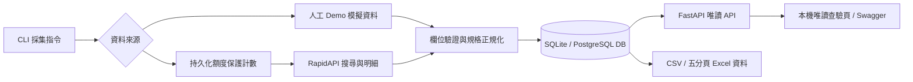

# gummy Amazon 採集 MVP

目前排程管理已支援每日／每週多星期／單次、多分類採集與自動產報，操作與切換注意事項見 [循環排程說明](docs/RECURRING_SCHEDULES.md)。

**先在本機跑通，再將同一個 Python worker 與 API 容器搬到雲端。** 本階段不需要 GCP、付費代理、Docker 或 API 金鑰即可測試完整資料流程。`gummy` 是 API Service 平台名稱。

此專案將先前的完整架構拆成可驗收的小版本。現階段以本文件與 [開發規格](docs/DEVELOPMENT.md) 為準；`output/` 的架構規格書是後續擴充參考，並不代表那些功能都已實作。

## 已實作範圍

- **V9／V10 本機版已完成**：[排程管理](http://127.0.0.1:8012/schedules)可編輯明天起的時間、分類及件數，預覽用量後保存版本，立即暫停／啟用；[報表中心](http://127.0.0.1:8012/reports?source=rapidapi)可查期間、保存固定範圍、下載 CSV／Excel 及零 API 重產版本。操作與界線見 [V9／V10 文件](docs/OPERATIONS_V9_V10.md)。已存資料的 10/04～10/06 第一期 6 件商品報表已完成，原每日報表保留。

- **V8 本機營運中心**：[首頁](http://127.0.0.1:8012/?source=rapidapi)可查看背景執行器、平台與供應商額度、歷史結果及未來排程。立即採集先預覽再確認，使用持久背景任務；可取消、追蹤進度、下載已驗證 Excel，或由已存資料零 API 重產報表。原營運功能與限制見 [V8 文件](docs/OPERATIONS_V8.md)。

- **V8.1 Python 獨立排程**：每日台灣 10:00 採集、10:10 產生 Excel；工作紀錄、重啟去重、報表及讀回驗證都不依賴 Codex／Node。原日曆工作與 Codex 跟進已停用，目前 Mac 常駐程序已驗證；換電腦操作與平台界線見 [Python 排程說明](docs/PYTHON_SCHEDULER.md)。
- Python 手動批次：一個 US 分類、一組關鍵字、搜尋第一頁、最多兩筆商品明細。
- SQLite 本機入庫、每批獨立快照、失敗批次不替換成功報表。
- gummy 讀取 API：商品、規格組合、版本資訊、CSV 下載、額度帳本。
- 本機[取樣分析](http://127.0.0.1:8012/analysis?source=rapidapi)：按台灣日期、分類、品牌及價格帶篩選，先取每個 ASIN 最新一次，再統計取樣均價、已知累計評分數與已存評論樣本；統計／商品明細 CSV 使用同一固定範圍。操作與限制見[取樣分析說明](docs/WORKBOOK_UI.md#2026-10-05-v4每期取樣分析)。
- 本機「來源查驗」直接顯示留存評論原文、星等、日期與評價數，不需人工或 AI 評論分類；新 XLSX 提供「規格映射」「評論來源」分頁，所有資料表保留實際儲存格框線。來源未提供的主題／正負向保持未提供，操作見 [v6 說明](docs/WORKBOOK_UI.md#2026-10-05-v6以採集來源為基準)。
- 可重複執行 `export-combinations`，將同一 ASIN 的規格交集輸出成 Excel 可開啟的組合表。
- 同規格多值採 OR，不同規格採 AND；以同一 ASIN 的實際規格交集分組。
- 若明細缺少公制／英制欄位，可選擇使用標題中明寫的 `Metric`／`SAE` 作**未驗證候選分類**；結構化欄位仍保留缺值。
- RapidAPI adapter：每批最多三次 HTTP 請求，無自動重試；預設每天五次、此資料庫生命週期累計三十次的上限。若回應提供供應商額度標頭，會保守保存這把金鑰的上次剩餘估計，下一批請求前也會檢查；它不等於帳號即時餘額。
- 新採集批次保存供應商回應中用於轉換的少量原始欄位，可匯出來源與入庫欄位對照表；舊批次不會補造原始證據。
- `verify-run` 可離線檢查每筆來源證據與入庫的 ASIN、標題、價格、品牌、結構化規格與評分是否一致；舊批次缺證會回報 `INCOMPLETE`。
- 本機排程入口與 macOS LaunchAgent 已完成單日真實來源試跑：2026-10-03 09:00 自動產生 run_id=5，取得 2 筆商品並通過來源對帳；試跑後已卸載排程。
- 2026-10-03 另以手動有限額取樣取得 run_id=6 六角扳手 1 筆；來源對帳通過，五頁 Excel 的參考分類覆蓋為 2/22。本機帳本累計 9/30、UTC 當日 5/5，當日不再呼叫 RapidAPI。
- 已新增跨批次分類活頁簿：原表 22 類總覽、分類規格組合、跨分類商品、來源對帳索引、完整來源欄位對照，以及每個已取樣分類獨立分頁；人工分類與來源核對預設「待確認」，可從上次人工核對檔安全承接。匯出後會逐列讀回核對資料與拒絕公式；這是本機作業，不消耗 RapidAPI 額度。
- 本機唯讀查驗畫面與五分頁 Excel 取樣報表已可使用；新增參考表 22 類的跨批次取樣覆蓋，操作與限制見 [畫面與報表](docs/WORKBOOK_UI.md)。
- Docker 映像已在本機建置，並以隔離網路完成容器 worker → PostgreSQL → 容器 API 的 demo 端到端測試；另通過 PostgreSQL 並行額度預留測試。GCP 服務仍待部署驗證。
- 已載入 2026-10-04 至 10-08 的有限期手工具多分類排程：五類各最多兩件。2026-10-06 已依要求改為每天台灣時間 10:00 採集、10:10 產出分類活頁簿；10-04 至 10-06 的批次及報表均已完成，10-07／10-08 待執行。報表不增加 RapidAPI 用量；詳見[本機排程](docs/LOCAL_SCHEDULE.md)。

尚未實作：原試算表八種報表的完整重建、雲端 UI、真實月銷量、完整評論分布分析、已確認規格映射的套用、歷史回填、付費代理與直接爬 Amazon HTML。單日試跑排程已成功後卸載；2026-10-04 至 10-08 的五天手工具試點排程已切換為本機 Python 常駐程序，目前每天台灣時間 10:00 嘗試一批，實際成功與否仍須依批次及來源驗證判定。模擬資料絕不可拿來判斷商品行情。

---

## 📌 專案架構與元件分析

### 1. 資料流圖 (Dataflow)



### 2. 目錄結構與模組分工 (Directory & Modules)

```
Rapid/
├── gummy/                     # 主程式套件
│   ├── __init__.py
│   ├── api.py                 # FastAPI 唯讀 API 端點 (/v1/products, /v1/combinations, etc.)
│   ├── classification.py      # 商品標題之 Metric / SAE 候選詞辨識邏輯
│   ├── cli.py                 # CLI 入口與指令解析 (gummy collect, serve, export, etc.)
│   ├── config.py              # 環境變數與驗證設定 (Settings)
│   ├── db.py                  # SQLAlchemy ORM、DB Schema、SQLite/Postgres 連線與交易
│   ├── errors.py              # 自訂異常定義 (GummyError)
│   ├── models.py              # Pydantic 資料模型、規範與數據驗證
│   ├── reports.py             # 規格交集計算、組合分組、報表與 CSV 生成
│   ├── python_scheduler.py    # Python 每日時鐘、持久工作紀錄與近期回報
│   ├── portable_workbook.py   # 純 Python XLSX 產生與來源讀回驗證
│   ├── scheduled.py           # 舊排程 run-key 產生與 LaunchAgent 邏輯
│   ├── sources.py             # Demo 模擬資料來源與 RapidAPI HTTP Adapter
│   ├── worker.py              # 單次採集 Job 流程控制 (檢查額度 -> 採集 -> 入庫)
│   ├── workbook_data.py       # 五分頁報表資料整理
│   └── ui.py                  # 本機唯讀查驗頁
├── scripts/                    # 本機五分頁 Excel 產生器與單一指令入口
├── docs/                      # 詳細設計與運營說明文件
│   ├── DEVELOPMENT.md         # 開發規格、資料表與 API 契約
│   ├── CLOUD_RUN.md           # 雲端 Cloud Run 與 PostgreSQL 部署指南
│   ├── PYTHON_SCHEDULER.md    # 獨立排程啟動、時間調整與換電腦
│   ├── LOCAL_SCHEDULE.md      # 本機排程與歷史來源對帳說明
│   ├── VALIDATION.md          # MVP 驗證結果與測試報告
│   └── WORKBOOK_UI.md         # 本機畫面與五分頁報表使用說明
├── exports/                   # 匯出的 CSV/JSON 資料檔 (已加 .gitignore)
├── data/                      # 本機 SQLite 資料庫 (gummy.db) 與排程 plist
├── output/                    # 架構規格書檔 (Word)
├── outputs/                   # 本次 Excel 驗證產物
├── tests/                     # Pytest 單元測試與 HTTP 模擬測試
├── Dockerfile                 # 容器化打包檔
├── compose.postgres.yml       # 本機 PostgreSQL 測試 Docker Compose
├── pyproject.toml             # Python 專案與依賴設定檔
└── requirements.lock.txt      # 鎖定版本的套件清單
```

### 3. 資料庫 Schema (Database Structure)

| 資料表 (Table) | 主鍵 / 索引 | 說明與用途 |
|---|---|---|
| `collection_runs` | `id`; `UNIQUE(source, run_key)` | 紀錄每次採集作業的參數、狀態 (`RUNNING`/`SUCCEEDED`/`FAILED`) 與錯誤訊息 |
| `product_snapshots` | `(run_id, asin)` | 儲存標準化後的商品資訊（ASIN、標題、品牌、USD 價格、評分、規格 JSON 等） |
| `source_observations` | `(run_id, asin)` | 留存供應商回傳的原始欄位值，供稽核與來源對帳 |
| `quota_budgets` | `name` | 持久化額度記帳，紀錄此 DB 累計與每日 UTC 使用次數 |
| `api_attempts` | `id` | 紀錄 HTTP 請求歷史、endpoint 與 response status code |

---

## 初次使用：全新專案

**收到交接 ZIP 且要保留對方資料時，請直接使用下方「搬移與交接」，不要執行此節的 demo 採集。** 本節只適用於沒有舊資料的新專案。

需要 Python 3.12 或以上。先進入專案資料夾，macOS／Linux：

```bash
cd /你的路徑/Rapid
python3 --version
python3 -m venv .venv
.venv/bin/python -m pip install -c requirements.lock.txt -e .
cp .env.example .env
chmod 600 .env
.venv/bin/gummy collect --source demo --run-key demo-first
.venv/bin/gummy serve --port 8012
```

Windows PowerShell（先進入專案資料夾）：

```powershell
cd C:\你的路徑\Rapid
py -3.12 -m venv .venv
.venv\Scripts\python.exe -m pip install -c requirements.lock.txt -e .
Copy-Item .env.example .env
.venv\Scripts\gummy.exe collect --source demo --run-key demo-first
.venv\Scripts\gummy.exe serve --port 8012
```

`tzdata` 已包含在專案依賴內。安裝套件需要網路；上述 demo 不需要 API 金鑰，也不消耗 RapidAPI 額度。

開啟 [demo 首頁](http://127.0.0.1:8012/?source=demo) 或 [API 操作頁](http://127.0.0.1:8012/docs)。首次先看 demo；切換 `source=rapidapi` 不會自動採集真實商品。**啟動網站只會提供介面，不會啟動排程或背景任務。** 若埠被使用，換一個埠並同步修改網址。

```bash
curl 'http://127.0.0.1:8012/v1/products?source=demo'
curl -X POST http://127.0.0.1:8012/v1/combinations/query \
  -H 'Content-Type: application/json' \
  -d '{"filters":{"material":["steel"],"measurement_system":["metric"]},"group_by":["material","measurement_system"]}'
```

預期模擬結果：兩筆商品中只有一筆同時符合 `steel + metric`，平均價格為 `10.50 USD`。這是人工測試資料，不是 Amazon 搜尋結果。

另開終端匯出 Excel 可讀的 CSV：

```bash
.venv/bin/gummy export --source demo --output exports/demo-products.csv
```

已有同名檔案時會拒絕覆寫；請指定新檔名。CSV 使用 UTF-8 BOM，包含來源、是否模擬、ASIN、分類、規格、價格、評分、觀測時間與警示，可直接在 Excel 篩選或製作樞紐分析表。

真實商品若缺少結構化 `measurement_system`，CSV 另外提供 `title_measurement_candidates` 與 `title_measurement_evidence`。例如 `metric;sae` 表示標題同時提到兩種規格，**尚未驗證每個套筒實際包含的尺寸**；不要將候選欄覆蓋到空白的結構化欄。組合查詢預設只用結構化資料；設 `include_title_candidates=true` 才會把標題候選納入分析。同一 ASIN 可同時出現在 Metric 和 SAE 兩群，群組商品數不能直接相加當作不重複商品數。

要產出第一版規格組合分類表，可對已入庫的批次執行：

```bash
.venv/bin/gummy export-combinations --source rapidapi --run-id 3 \
  --group-by material measurement_system --include-title-candidates \
  --output exports/amazon-run3-combinations.csv
```

每列是一個實際出現的規格組合，包含組合商品數、平均 USD 價格、ASIN 清單、標題候選 ASIN 清單與批次時間。它對照原範本的「類別／規格／細項」分類思路，指標是**本批取樣商品數**，不是範本中的歷史銷量或 `score_rank`。此次示範的「套筒扳手」也不是原範本 22 類之一；需後續選定同名類別才能做逐欄對照。

若需要可直接開啟的五分頁 Excel，可執行 `scripts/export_workbook_local.sh rapidapi 5 exports/amazon-run5-new.xlsx`；該指令讀取現有批次，不消耗外部額度，並拒絕覆寫已有檔案。完整說明見 [畫面與報表](docs/WORKBOOK_UI.md)。

排程開發時先以 `scheduled-collect --source demo --dry-run` 驗證，再用 demo 實際執行兩次確認同日批次只寫入一次。`schedule-plist` 本身只產生設定檔；本機 2026-10-03 09:00 的單日真實試跑已成功並卸載，結果與停用方式見 [本機排程與來源對帳](docs/LOCAL_SCHEDULE.md)。`export-audit` 可將 run_id=5 保存的來源欄位與入庫值並列，供人工抽查。既有 run_id=3 在此功能加入前完成，來源欄位會明確標為未留存，不能事後補造。

## 搬移與交接：保留現有商品、報表與排程

**交付一份工具產生的 ZIP 即可，不必再手動搬 `gummy.db`，也不要搬 `.venv`。** 資料庫已包含在 ZIP 的 `data/gummy.db`；接收端重新建立 Python 環境，再執行準備工具修正舊報表路徑。

此功能支援本機 SQLite、專案內資料庫，以及位於專案根目錄的排程設定 JSON；PostgreSQL 搬移不適用此工具。請將接收端視為獨立副本：搬移不提供兩台同步，也不提供跨機器額度鎖。開啟兩台網站看資料可以，但正式接手採集時只能保留一台採集器。

### 1. 舊電腦：確認交接時間並停止採集

演練打包可以在無任務的空檔進行；**正式接手前，先停止舊機排程派發，讓已入列及進行中的任務完成，再停止背景任務與網站，最後重新打包。** 打包後若舊機又有新資料，ZIP 不會自動更新。

目前這台 Mac 若使用既有 LaunchAgent，依序處理如下。停止排程後，先從網站確認沒有「待執行／執行中」任務，再執行後兩行：

```bash
launchctl bootout "gui/$(id -u)" "$HOME/Library/LaunchAgents/com.woobe.gummy.scheduler.plist"
# 等背景工作完成、確認沒有待執行／執行中任務，再停止下列兩個服務。
launchctl bootout "gui/$(id -u)" "$HOME/Library/LaunchAgents/com.woobe.gummy.tasks.plist"
launchctl bootout "gui/$(id -u)" "$HOME/Library/LaunchAgents/com.woobe.gummy.ui.plist"
```

上述只適用於已安裝這三個服務的 Mac。一般前景執行的使用者，在沒有工作進行時以 Ctrl+C 停止；Linux／Windows 停止自己安裝的服務。LaunchAgent 卸載不會刪除資料；若正式交接後不再使用舊機，還要避免舊服務在下次登入時重新載入，可將這三個 plist 移出 `~/Library/LaunchAgents` 保存。不必安裝或啟動 Codex。

### 2. 舊電腦：一個指令打包

macOS／Linux，在原專案根目錄執行：

```bash
cd /Users/eddiechu/Program/Rapid
.venv/bin/python scripts/transfer.py export
```

Windows：

```powershell
.venv\Scripts\python.exe scripts/transfer.py export
```

完成後顯示 `output`（ZIP 位置）、`sha256` 及各資料表的筆數／核對摘要。預設放在 `transfer/gummy-transfer-時間.zip`；每次產生新檔，不覆寫舊包。也可用 `export --output transfer/交接檔名.zip` 指定新檔名。

工具會先取得與採集／排程／手動任務共用的鎖；有待執行或進行中任務時拒絕打包。以 SQLite 備份介面取得一致快照，檢查完整性與關聯，再核對 ZIP 讀回結果；不直接複製正在寫入的 WAL，不呼叫供應商，不修改原資料庫、排程或額度。

| 放入交接包 | 不放入交接包 |
|---|---|
| Python 程式、安裝清單、操作文件 | `.venv`、`.work`、快取與舊 ZIP |
| DB：商品、來源、評分／評論、批次、額度、規則版本與歷史 | 原機 `.env`、RapidAPI key、平台 token |
| `exports/` 的 XLSX、CSV、JSON 驗證檔 | 日誌、歷史 DB 備份、鎖與 WAL／SHM |
| 原計畫、排程設定、已存在的排程狀態檔 | 已安裝的 LaunchAgent／systemd／工作排程器設定 |
| 無金鑰的 `transfer.env`、校驗清單 | Codex 環境、原始參考 Excel／架構 Word 產物、開發測試目錄 |

商品與報表仍屬內部資料；ZIP 的雜湊可用於檢查傳輸一致性，**ZIP 本身沒有加密**。透過受控管道交給對方；不要公開上傳。發送端會檢查包內是否意外包含目前設定中的 API key 或平台 token，發現時拒絕輸出；這不取代對其他敏感資料的人工確認。

### 3. 新電腦：解壓並重建環境

將 ZIP 解壓到**全新的資料夾**（例如 `~/Program/gummy`），確認根目錄有 `README.md`、`gummy/`、`scripts/`、`data/`、`transfer-manifest.json`。不要覆蓋另一份正在使用的 gummy。

macOS／Linux：

```bash
cd ~/Program/gummy
python3 --version
python3 -m venv .venv
.venv/bin/python -m pip install -c requirements.lock.txt -e .
.venv/bin/python scripts/transfer.py prepare
```

Windows PowerShell：

```powershell
cd C:\Program\gummy
py -3.12 -m venv .venv
.venv\Scripts\python.exe -m pip install -c requirements.lock.txt -e .
.venv\Scripts\python.exe scripts/transfer.py prepare
```

`prepare` 驗證檔案雜湊、資料庫內容與結構，將已登錄報表位置換成新資料夾，建立無金鑰的 `.env`，保留額度帳本、規則、來源與歷史。**它不採集、不啟動服務、不重設剩餘次數，舊機心跳是打包當時的紀錄，過期後會顯示離線；新機在線狀態須依實際啟動後的心跳確認。** 同一位置重複執行回報 `already_prepared`，不覆寫設定；有既存 `.env` 或檔案不一致時停止。準備後若再次換位置，從目前可用機器重新 `export` 後交接，不直接移動已準備的資料夾。

### 4. 新電腦：先驗證舊資料能讀取

macOS／Linux：

```bash
.venv/bin/gummy quota
.venv/bin/gummy serve --port 8012
```

Windows 將 `.venv/bin/gummy` 替換成 `.venv\Scripts\gummy.exe`。先只開網站，檢查：

1. [商品](http://127.0.0.1:8012/products?source=rapidapi)：批次 ID、ASIN、價格、評價數與原機相同。
2. [報表中心](http://127.0.0.1:8012/reports?source=rapidapi)：下載一份舊 XLSX，核對分頁及內容。
3. [排程](http://127.0.0.1:8012/schedules)：規則、循環、分類與歷史保留；尚未啟動 Python 排程器是正常狀態。
4. `quota`：累計用量保留。每日帳本依 UTC，跨日時日期與當日用量可能不同；供應商最近剩餘估計不是即時帳號餘額，新金鑰也不沿用舊金鑰的估計。

以上全為本機讀取，不消耗 API。搬來的資料若是 demo，將網址改為 `source=demo`。不要為了測試搬移而再次 `collect`，也不要刪除 DB 來清空帳本。

### 5. 新電腦：確認接手後才啟動採集

若對方只要查詢／匯出，停在第 4 步即可。若要繼續抓取：

1. 再次確認舊機排程及背景採集已停止，且 ZIP 是停止後的最新版本。
2. 使用接收端自己的 RapidAPI 免費訂閱與金鑰。在本機執行 `.venv/bin/gummy configure-rapidapi` 安全輸入，不把金鑰貼到聊天；這個設定指令本身不發出 API 請求。確認實際訂閱是免費方案且有硬上限後，在新機 `.env` 將 `RAPIDAPI_FREE_PLAN_CONFIRMED=false` 改成 `true`。保存並重啟網站，才能讀取新設定；不能因搬移就假設已確認。
3. 檢查本機累計／每日額度及 RapidAPI 控制台，確認是否足以繼續。新金鑰下的供應商剩餘估計可能未知，沿用既有檢查與確認流程，不繞過保護或重設帳本。
4. 若有排程設定，執行 `.venv/bin/gummy scheduler --config python-scheduler.json --check` 唯讀檢查。若交接包使用其他檔名，依 `.env` 的 `GUMMY_SCHEDULER_CONFIG` 替換；沒有排程設定時此步驟不適用，須另依排程文件建立基礎計畫與設定後才啟動。過去成功／漏跑紀錄不補抓，超過容許時間的舊日期不重跑。
5. 另開兩個終端，在相同專案資料夾各執行一個程序：

```bash
# 終端 A：執行網頁確認的任務及排程入列工作。
.venv/bin/gummy task-worker
# 終端 B：判斷到期的規則；可能派發採集，不是唯讀檢查。
.venv/bin/gummy scheduler --config python-scheduler.json
```

網站、背景任務與排程器共三個程序，必須共用同一資料夾、設定與 DB。啟動後依網站檢查服務是否在線、下次執行時間與第一筆實際結果。**啟用規則不代表電腦一定在線；睡眠、關機或程序停止時不會按時採集。**

確認前景運作後，在新機重新產生自動啟動設定，見 [Python 排程部署說明](docs/PYTHON_SCHEDULER.md#3-先前景測試再設定開機啟動)；不要直接複製原機安裝檔。Mac 本機已驗證，Linux／Windows 的設定與檔案鎖仍需接收端實機驗收。需要多機同步或雲端共用 DB 時，應另做部署，不能用兩份 ZIP 取代同步機制。

目前 `scheduler_startup.py` 只產生排程器的常駐設定，**網站及 `task-worker` 仍需維持前景運作，或另在新機設定常駐**。只安裝 scheduler 而沒有 worker，工作會入列但不會採集。交接工具不會自動安裝這些服務。

### 常見狀況

| 狀況 | 處理方式 |
|---|---|
| `no such file or directory: .venv/bin/gummy` | 先進入專案根目錄；新機尚未安裝時先建立 `.venv` 與安裝套件 |
| 打包顯示有待執行／進行中工作 | 等待完成，或從網站取消尚未執行的任務；不要修改 DB 狀態強行打包 |
| 解壓後檔案校驗失敗／舊報表不存在 | 重新傳輸 ZIP，必要時從舊機重新打包；不要忽略驗證繼續採集 |
| `prepare` 顯示已有 `.env` | 使用全新的解壓資料夾；工具不會覆寫既有設定 |
| 新機只有網站、排程顯示離線 | 尚未啟動 scheduler 與 task-worker；先完成接手確認再啟動 |
| 額度不足或供應商估計未知 | 核對原機用量及控制台，照既有流程處理；搬移不會恢復免費次數 |

### CLI 命令一覽表

| 指令 (Command) | 說明 |
|---|---|
| `gummy init-db` | 初始化 DB schema (本機 SQLite 用) |
| `gummy quota` | 查看持久化 API 配額消耗狀況 |
| `gummy collect` | 執行單次採集批次 (`--source demo` 或 `rapidapi`) |
| `gummy scheduled-collect` | 按台灣日期執行的冪等批次採集 |
| `gummy schedule-plist` | 產生 macOS LaunchAgent 排程設定檔 (plist) |
| `gummy plan-validate` | 唯讀檢查有限期分類計畫、額度與各日期狀態 |
| `gummy run-plan` | 只在計畫指定日期執行當天批次；`--dry-run` 不發請求 |
| `gummy plan-plist` | 產生有 SHA-256 保護的有限期分類排程設定檔 |
| `gummy serve` | 啟動 FastAPI 唯讀 API 服務 |
| `gummy export` | 匯出單一 ASIN 平面商品 CSV |
| `gummy export-combinations` | 匯出規格組合分組矩陣 CSV |
| `gummy export-audit` | 匯出來源原始欄位與入庫值對照 CSV |
| `gummy export-workbook-data` | 匯出多工作表報表用資料 JSON，不發出外部請求 |
| `gummy verify-run` | 離線檢查成功批次與來源證據的一致性；不通過時回傳非零代碼 |

---

## 使用免費 RapidAPI 測試

1. 在 RapidAPI 訂閱 **Real-Time Amazon Data / OpenWeb Ninja**，先確認自己的方案是免費且有硬上限。不同供應商與不同入口的金鑰不能混用。
2. 複製 `.env.example` 為 `.env`，將金鑰填入本機檔案，不要貼到聊天、程式碼或 Git。將 `RAPIDAPI_FREE_PLAN_CONFIRMED=true`。
3. 檢查 RapidAPI 控制台剩餘額度至少三次；本機帳本看不到控制台及其他程式的使用量。
4. 執行：

```bash
.venv/bin/gummy quota
.venv/bin/gummy collect --source rapidapi --run-key free-test-001
.venv/bin/gummy export --source rapidapi --output exports/amazon-free-test-001.csv
```

真實資料查詢需明確選來源，例如 `/v1/products?source=rapidapi`。API 預設 `source=demo`，兩種資料不混合。成功批次重用相同 `run-key` 和參數不會再呼叫供應商；失敗或中斷的批次需先檢查額度，再以新 `run-key` 手動重跑。

本機查驗頁另外顯示五天分類採集排程，唯讀端點 `/v1/plan` 可取得逐日狀態與 Python 程序近期回報；它不會發送供應商請求。詳見[本機排程與來源對帳](docs/LOCAL_SCHEDULE.md)。

截至 2026-10-01，[供應商官方頁](https://www.openwebninja.com/api/real-time-amazon-data) 列出其免費方案為每月 100 次請求、硬上限；**RapidAPI 帳戶實際訂閱與剩餘額度仍須由自己的控制台確認**。本版只連 RapidAPI 入口，沒有接供應商直連入口。

`LIVE_TOTAL_LIMIT=30` 是本機保守測試預算，**不會每月自動歸零**。最多十批完整測試；計費失敗、逾時、程式中斷前的保留額度也不退回。不要刪除資料庫、複製到另一台主機或更換帳本來重置額度。這個帳本不是供應商的費用保證。

---

## 📊 匯出產物與資料格式說明

執行 `gummy export*` 指令時，產物預設會儲存在 `exports/` 目錄中：

### 1. 單一商品平面表 (`gummy export --output exports/demo-products.csv`)
- **檔案**：`exports/products.csv` (或指定檔名)
- **內容**：包含所有採集到的商品明細，一列代表一個 ASIN。包含帶有 UTF-8 BOM 標頭的 CSV，可直接以 Excel 開啟。
- **主要欄位**：
  - `source`：資料來源 (`demo` / `rapidapi`)
  - `asin`：Amazon 商品識別碼
  - `title`, `brand`, `price_usd`：商品標題、品牌、美元價格 (Decimal 格式)
  - `rating`, `ratings_total`：評分與評價總數
  - `material`, `measurement_system`, `size`, `color`：結構化規格欄位
  - `title_measurement_candidates`：當結構化公/英制缺值時，自標題擷取的候選值 (如 `metric;sae`)
  - `title_measurement_evidence`：標註未驗證標題候選分類標記 (`unverified_title_keyword`)

### 2. 規格組合分組表 (`gummy export-combinations --output exports/combinations.csv`)
- **檔案**：`exports/combinations.csv` (或指定檔名)
- **內容**：針對同一 ASIN 的實際規格交集進行分組，一列代表一個規格組合（例如：`steel + metric`）。
- **主要欄位**：
  - `classification_mode`：`structured_only` 或 `title_candidates_opted_in`
  - `material`, `measurement_system`, `size`, `color`：規格維度
  - `group_product_count`：該規格組合命中的商品數量
  - `priced_product_count`：其中含有有效價格的商品數
  - `average_price_usd`：該組合的平均美元價格
  - `asins`：屬於此規格組合的 ASIN 清單 (以分號 `;` 隔開)
  - `title_candidate_asins`：包含標題候選值的 ASIN 清單

### 3. 來源對帳稽核表 (`gummy export-audit --output exports/source-audit.csv`)
- **檔案**：`exports/source-audit.csv` (或指定檔名)
- **內容**：將 API 原始回傳值與正規化入庫值並列，方便人工抽查資料轉換準確度。

---

## 🧪 測試與文件

```bash
.venv/bin/python -m pytest -q
.venv/bin/ruff check .
.venv/bin/ruff format --check .
```

測試使用人工資料和 HTTP 模擬，不呼叫外部 API。

- [開發規格、資料表與 API 契約](docs/DEVELOPMENT.md)
- [本機／Cloud Run 選型與遷移步驟](docs/CLOUD_RUN.md)
- [參考表 22 類覆蓋與免費額度計畫](docs/COVERAGE_PLAN.md)
- [本次驗證結果](docs/VALIDATION.md)
- [本機排程與來源對帳](docs/LOCAL_SCHEDULE.md)
- [本機查驗畫面與五分頁報表](docs/WORKBOOK_UI.md)

`.env`、`data/`、`exports/`、`outputs/` 已排除於版本控制與容器建置內容。預設只監聽 `127.0.0.1:8010`；對外監聽必須設定至少 32 字元的 `GUMMY_API_TOKEN`。正式部署還需要 HTTPS、IAM、權限分離及 Cloud SQL 驗證。
