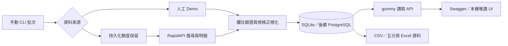

# gummy 免費額度 MVP 開發規格 v0.1

日期：2026-10-01。目標：先證明程式正常運作，再討論擴大量、排程與成本。

2026-10-03 狀態更新：真實 run_id=5 已由 09:00 單日 LaunchAgent 自動取得兩筆取樣，run_id=6 又手動取得一筆六角扳手；來源對帳均為 `PASS`。本機唯讀 UI、五分頁 Excel 取樣報表和離線 `verify-run` 均已驗證。分類覆蓋頁顯示原表 22 類中已取樣 2 類，不代表市場覆蓋率。單日排程完成後已卸載；10/04–10/08 的五天有限期排程已載入，但截至 10/03 尚未實跑。下文描述初版設計時的限制；操作現況以 [驗證紀錄](VALIDATION.md)、[排程](LOCAL_SCHEDULE.md)及[畫面與報表](WORKBOOK_UI.md)為準。

## 1. 成功條件與範圍

| 編號 | 可驗收結果 | 驗證方式 |
|---|---|---|
| A1 | 不需金鑰即可完成採集、入庫、查詢及匯出 | demo CLI + HTTP/API 測試 |
| A2 | 成功批次重跑不重複插入、不多耗 API 額度 | 相同 run-key 執行兩次 |
| A3 | 規格組合使用同一商品的交集 | steel + metric 只命中一筆模擬 ASIN |
| A4 | null 價格不變成零，來源與時間可追溯 | 正規化及匯出測試 |
| A5 | 逾時、429、錯誤資料不替換上一份成功報表 | HTTP 模擬故障測試 |
| A6 | 額度先記帳、超額不送出、多執行緒不突破上限 | 並行保留額度與重開 DB 測試 |
| A7 | 金鑰不輸出到 API、CSV、錯誤或版本控制 | 白名單輸出與錯誤遮蔽測試 |
| A8 | 有金鑰後完成一批真正免費 API 採集 | 獨立現場驗證，不能由 mock 測試替代 |

現階段只有 US/USD、一個批次最多兩個 ASIN。分類名稱由操作人員指定，僅表示這次搜尋的收集範圍，不宣稱自動完成原試算表的 QFD 分類。`query` 不同代表取樣母體不同，不可直接比較為全站排名。

## 2. 元件與資料流



| 檔案 | 責任 |
|---|---|
| `gummy/config.py` | 環境設定、live 啟用條件、監聽與預算限制 |
| `gummy/sources.py` | 模擬來源與固定 RapidAPI host 的 HTTP adapter |
| `gummy/models.py` | 輸入驗證、US 金額處理、規格映射 |
| `gummy/classification.py` | 商品標題中明寫的 Metric／SAE 候選詞；只作可選、未驗證分類 |
| `gummy/db.py` | DB schema、批次狀態、快照、原子額度計數 |
| `gummy/worker.py` | 一批採集的執行流程與失敗處理 |
| `gummy/reports.py` | 規格交集、分組、CSV 與價格統計 |
| `gummy/api.py` | 已入庫資料的唯讀 HTTP API |
| `gummy/cli.py` | 初始化、採集、查詢額度、匯出、啟動 API |

API 沒有觸發採集的端點，避免使用者刷新頁面就消耗免費額度。worker 由外部呼叫一次並結束；`scheduled-collect` 以台灣日期產生固定 run-key，`schedule-plist` 只產生 macOS 設定檔。單日試跑排程已完成並卸載，沒有常駐循環或自行重試。

## 3. 採集契約與計費保護

來源固定 `https://real-time-amazon-data.p.rapidapi.com`，TLS 憑證驗證開啟，認證放在 `X-RapidAPI-Key` 與 `X-RapidAPI-Host`。不接受任意 URL，不跟隨重新導向、不讀環境代理設定，避免金鑰被送至其他位置。

| 操作 | 路徑與參數 | 上限 |
|---|---|---|
| 搜尋 | `/search`：query、country=US、page=1、sort_by=RELEVANCE | 1 次／批 |
| 明細 | `/product-details`：asin、country=US | 最多 2 次／批 |
| 評論、Offers、歷史價格 | 尚未呼叫 | 0 |

搜尋需含 `data.products`；明細需含 `data` 物件。若回傳 status，必須為 OK。ASIN 為十碼大寫英數，明細 ASIN 必須與請求一致。搜尋頁先去重，再取前兩個 ASIN。空結果視為失敗，保留既有報表。

每次網路 I/O 前先在同一 DB 交易中增加 lifetime 與 UTC 當日計數，並新增 `api_attempts`。額度提交成功後才發送請求。timeout、429、503、schema 錯誤、中斷都不退額度。HTTP outcome 只存代碼，禁止儲存完整 provider body 或金鑰。

整批先檢查預算是否足夠；多 worker 同時執行時，仍以每次請求前的條件 UPDATE 作最終裁決。競爭額度可能讓批次中途失敗，但不會發布不完整報表或越過本機上限。DB 故障時不准送出未記帳的請求。

HTTP connect timeout 10 秒，其他 HTTPX timeout 30 秒（各 I/O 階段，不是整批 SLA）；單回應最多 2 MiB。完全不自動重試。每批最多三次請求，預設 UTC 每日五次、此 DB 累計三十次，設定不能超過三十次。供應商額度還可能包含其他帳號入口、流量或 endpoint 權重，本機計數不能取代供應商控制台。

## 4. 資料模型

| 資料表 | 主鍵／唯一鍵 | 內容 |
|---|---|---|
| collection_runs | id；UNIQUE(source, run_key) | 參數、來源、RUNNING/SUCCEEDED/FAILED、起訖時間、錯誤種類 |
| product_snapshots | (run_id, asin) | 標題、品牌、USD 價格、評分、評分數、specs JSON、觀測時間與警示 |
| source_observations | (run_id, asin) | 新批次供應商商品明細中參與轉換的選定原始欄位，供人工對帳 |
| quota_budgets | name | lifetime 或 day:YYYY-MM-DD 的已使用次數 |
| api_attempts | id | run_id、endpoint、保留時間與回應結果代碼 |

金額使用 NUMERIC/Decimal。API 以字串表示，例如 `"10.50"`；缺值用 null。評分與評分數不是銷量。保留 `price_raw` 供解析問題追蹤，但不儲存評論作者、cookie、原始整包評論或賣家聯絡資料。

已入庫的結構化規格僅讀 `product_information` 與 `product_details` 的明確欄位：Material→material、Measurement System→measurement_system、Size→size、Color→color。去除多餘空白、轉小寫，同名欄位以 product_details 為優先。不從標題填補缺失的**結構化欄位**，也不把 alloy steel、stainless steel 強制合併為 steel。缺值保留缺值。

2026-10-02 的第一批真實資料有兩筆商品、材質與價格均可讀，但 `measurement_system` 皆缺值。為測試分類流程，讀取端可從標題的完整 `Metric`／`SAE` 字詞產生獨立候選欄，標記 `unverified_title_keyword`。`1/4 inch` 不會自動推成 SAE；若結構化欄位已有值，以其為準。這一層不改寫商品快照，也不額外呼叫外部 API。標題可能是套裝、變體或廣告文案，所以候選分類不能替代人工／來源規格確認。

整批明細驗證完成後，商品快照與 SUCCEEDED 狀態在同一個交易提交。`latest` 只選該來源 id 最大的成功批次，失敗批次不參與。報表查詢先固定 run_id，再讀此批快照，不會混合不同版本。

本版 latest 是「該來源最後建立且成功的單批次」，不合併不同分類／keyword 的最新資料；分類輪巡與多範圍報表需後續增加 scope 表、索引及完整發布版本。歷史成功批次以 run_id 讀取，作為 CSV／API 的固定版本。

進程被強制終止可能留下 RUNNING 和 reserved 記錄。保留其額度與狀態，先確認舊進程已停止，再用新 run-key 重新採集；MVP 不提供自動回收或重置額度。資料庫不要手動刪改當成重跑方式。

## 5. gummy API 契約

預設 `source=demo`；真實資料需指定 `source=rapidapi`。跨來源的 run_id 回傳 404。

| 方法與路徑 | 用途 | 是否消耗外部額度 |
|---|---|---|
| GET /health | 檢查服務與 DB 連線 | 否 |
| GET /v1/reports/latest?source=demo | 最新成功批次、範圍、完成時間 | 否 |
| GET /v1/reports/verification?source=demo | 已留存來源欄位與入庫值的一致性結果 | 否 |
| GET /v1/products?source=demo&run_id=1 | 商品快照；run_id 可省略 | 否 |
| POST /v1/combinations/query | 同商品多規格交集與分組 | 否 |
| GET /v1/exports/products.csv | 全批商品 CSV；支援 source/run_id | 否 |
| GET /v1/exports/combinations.csv | 規格組合 CSV；可納入未驗證標題候選 | 否 |
| GET /v1/exports/audit.csv | 選定來源欄位與入庫值對帳 CSV | 否 |
| GET / （僅本機） | 最新成功快照與批次／額度查驗頁 | 否 |
| GET /v1/quota | 此 DB 累計與 UTC 當日帳本 | 否 |

POST 範例：

```json
{
  "source": "demo",
  "filters": {
    "material": ["steel"],
    "measurement_system": ["metric", "sae"]
  },
  "group_by": ["material", "measurement_system"]
}
```

同一 dimension 的值是 OR，多個 dimension 是 AND；group_by 最多三個維度。只輸出實際出現的組合，避免笛卡兒積製造不存在的商品。group_by 缺值會形成 null 群組；filters 缺該規格則不匹配。每群包含 ASIN 清單、商品數、有價格商品數、平均價格，不計算月銷量或市占率。

查詢可額外傳 `"include_title_candidates": true`，才把缺少結構化公制／英制值的商品標題詞納入篩選／分組。回應有 `classification_note` 與各群的 `title_candidate_asins`。同一商品若同時標示 Metric 與 SAE，可在兩群各計一次；`matched_product_count` 是不重複的商品數，群組數加總可能大於它。預設 `false` 維持純結構化分析。

參數錯誤 422；沒有成功報表 404；認證失敗 401；DB health 失敗 503。報表來源、is_demo、run_id、時間、取樣範圍及 `sales_metric_available=false` 隨回應輸出。schema 在本機 `/openapi.json` 提供。

商品 CSV 是一列一個 ASIN 的平面資料，可用 Excel 樞紐分析分類。API 可先試組合條件；CSV 匯出整批資料，不套用 POST 查詢條件。五分頁 Excel 取樣報表已提供，但不是原八分頁樣式的完整重建。CSV 的 `measurement_system` 保留來源結構化值；額外的 `title_measurement_candidates` 可含 `metric;sae`，`title_measurement_evidence` 標明這是未驗證標題詞。CSV 公式前綴 `= + - @` 的外來字串會加單引號，防止被當公式執行。

`gummy export-combinations` 另可輸出**一列一種規格組合**的 CSV：固定輸出 run_id、來源、分類、觀測批次時間、分類模式、不重複命中商品總數；將 `group_by` 維度展為 material／measurement_system／size／color 欄，再列組合商品數、有效價格商品數、USD 平均價、ASIN 與標題候選 ASIN。沒有的維度留白。`--include-title-candidates` 必須明確指定才允許候選值入組，預設仍是純結構化資料。這張表不含月銷量、銷售排名與市場占比，因現有 API 資料不足以推導。

原參考檔 `productSpecTableData` 的欄位是 Category、產品規格、產品規格細項、score_rank；大小規格熱度表使用 sum_sales。舊 run_id=3 的「套筒扳手」不在原參考檔的 22 個產品分類之中；新 run_id=5 已取樣其中的 `棘輪扳手(Ratchet Wrench)` 兩件商品，但不能以兩筆替代既有類別的歷史統計。此 MVP 證明可重複輸出的規格組合結構，擴大樣本仍須建立分類對應表。

原參考活頁簿八個分頁的對應狀態已按實際欄位盤點。第一批取樣只支援當批商品快照，不能重建歷史期間的銷售或評論統計：

| 原參考分頁 | 已取得的對應欄位 | 仍缺少的關鍵資料 |
|---|---|---|
| `QFD產品表` | 可沿用 Category 名稱；run_id=5 已取樣 `棘輪扳手(Ratchet Wrench)` | 跨類別完整樣本與 QFD 分數定義 |
| `BrandPositionChart` | 品牌、當批價格、評價數 | 圖中其他指標的業務定義與同期間來源 |
| `PriceRangeChartData` | 當批價格可分箱，評價數可讀 | 原表的總銷售金額；各分類的價格區間規則也不一致 |
| `monthlySalesChartData` | 當批平均價格 | 每月觀測序列與月銷售金額 |
| `customerFeedbackChartData` | 無評論內容 | 意見主題及正負向筆數 |
| `largeSpecificationHeatChartData` | 規格欄位與當批商品數 | `sum_sales` 銷售數據 |
| `smallSpecificationHeatChartData` | 規格細項與當批商品數 | `sum_sales` 銷售數據 |
| `productSpecTableData` | Category、規格、細項與證據類型 | `score_rank` 的定義與來源 |

目前五分頁報表使用「分類覆蓋／規格組合／商品明細／規格細項／來源對帳」等新名稱；它們提供可驗證的取樣結果與來源檢查，不冒用上述八個分頁的統計口徑。原表的價格區間標籤因分類而異，日後若要逐欄相容，必須先確定該分類的分箱規則。

原表與本機組合 CSV 的欄位對照如下；不同統計口徑不能直接換名沿用：

| 原表欄位 | 本機可用資料 | 對接條件 |
|---|---|---|
| `Category` | 採集批次的 `category` | 必須改用原表同名分類重新採樣；目前的「套筒扳手」不相同 |
| `產品規格`／`Spec` | `group_by` 維度，例如 `material`、`measurement_system` | 先建立規格名稱對應與同義詞表 |
| `產品規格細項`／`content_trim` | 組合列的規格值，例如 `metric` | 保留來源與候選標記；標題詞不得冒充已驗證規格 |
| `score_rank` | 無 | 需確認原表排名算法及資料期間，不能用樣本數假扮 |
| `sum_sales` | 無 | 需合法且可驗證的銷量資料來源，不能由價格、評價數或 2 筆搜尋結果推算 |

本機新增的 `group_product_count` 僅表示該批命中商品數；一件商品可因標題同時提及 Metric／SAE 而出現在兩個候選群。`matched_distinct_product_count` 才是不重複 ASIN 數。run_id=5 已選原表同名分類；22 類的取樣狀態、八分頁欄位缺口與免費額度試點界線見 [分類覆蓋與額度計畫](COVERAGE_PLAN.md)。

## 6. 安全與運作邊界

- 開發預設只綁 loopback，使用者自行以 uvicorn 直接對外啟動會繞過 CLI 綁定位址檢查，因此對外部署只使用受控啟動命令及 cloud 模式。
- 設定 GUMMY_API_TOKEN 後，除 /health 外的業務 API 皆需要 Bearer token。cloud 模式關閉 Swagger/OpenAPI，拒絕 SQLite；金鑰至少 32 字元。此 token 是 MVP 的單一服務憑證，正式版應改 OIDC/IAM 與角色權限。
- `.env` 不提交、不打包；API key 只交給 worker，未來 gummy API 身分不應有讀取此 secret 的權限。
- 本地 DB 是開發人員可存取的檔案，沒有檔案加密或多人隔離；正式版採 Cloud SQL 私有連線、worker writer 與 API reader 分離。
- 尚未執行第三方漏洞資料庫掃描；通過功能測試不等於完成資安稽核。
- `create_all` 只支援首次建立；正式 schema 升級需導入遷移工具，不能當成無停機升級機制。

## 7. 開發階段與排程

| 階段 | 交付與驗收 | 預計外部請求 |
|---|---|---|
| 1. 本機離線 | 本版 worker、DB、API、CSV、故障與額度測試 | 0 |
| 2. 免費串接 | 設定自己的免費金鑰，成功採一批、比對兩筆商品欄位 | 最多 3 |
| 3. 短期觀測 | 手動執行 7 天，每天一批；比對價格缺值及 schema 穩定度 | 最多 21，另留 6 次測試 |
| 4. PostgreSQL | 本機可選 DB 驗證、權限與遷移設計 | 不須外部 API |
| 5. 雲端試跑 | Cloud Run Job/Service、Cloud SQL、IAM，再啟用排程 | 另做成本與額度確認 |

本機有限期試驗固定台灣時間 09:10 執行，便於白天查看問題。2026-10-03 的單日 LaunchAgent 試跑已成功並卸載；10/04–10/08 的五天計畫已載入，第一天仍待實際驗證。睡眠時可能於喚醒補跑，關機錯過的排程不補跑。詳見 [本機排程與來源對帳](LOCAL_SCHEDULE.md)。穩定後再評估正式排程時間，並依實測完成時間決定報表截止時間。

每日三次若跑整月可能接近 100 次且沒有足夠除錯餘額，因此本版不直接開每日永久排程。累計三十次用完即停止，不自動切換付費方案。

## 8. 研究依據與取捨

- [Scrapy 官方](https://github.com/scrapy/scrapy)：有完整爬蟲管線與 middleware。當前只做三次結構化 API 請求，導入它會增加不必要元件；等到確定需要 HTML crawler 再評估。
- [Crawlee Python 官方](https://github.com/apify/crawlee-python)：提供 browser/HTTP crawler 能力；本版不需要瀏覽器池或 paid proxy。
- [供應商官方 Python 範例](https://www.openwebninja.com/blog/how-to-get-amazon-product-data-python)：核對 search/product-details 參數及 data 結構；其示範為直連入口，金鑰標頭與本版 RapidAPI 入口不同。
- [供應商方案與雙入口說明](https://www.openwebninja.com/api/real-time-amazon-data)、[RapidAPI 方案頁](https://rapidapi.com/letscrape-6bRBa3QguO5/api/real-time-amazon-data/pricing)：免費配額以實際訂閱為準。
- [SQLAlchemy 交易文件](https://docs.sqlalchemy.org/en/20/orm/session_transaction.html)、[HTTPX MockTransport](https://www.python-httpx.org/advanced/transports/)：使用持久交易控制發布／配額，用 mock 驗證失敗而不耗 API 額度。

外部開源範例只用於設計研究，本版程式自行建構，沒有直接複製 Amazon 爬蟲專案或代入其授權。
