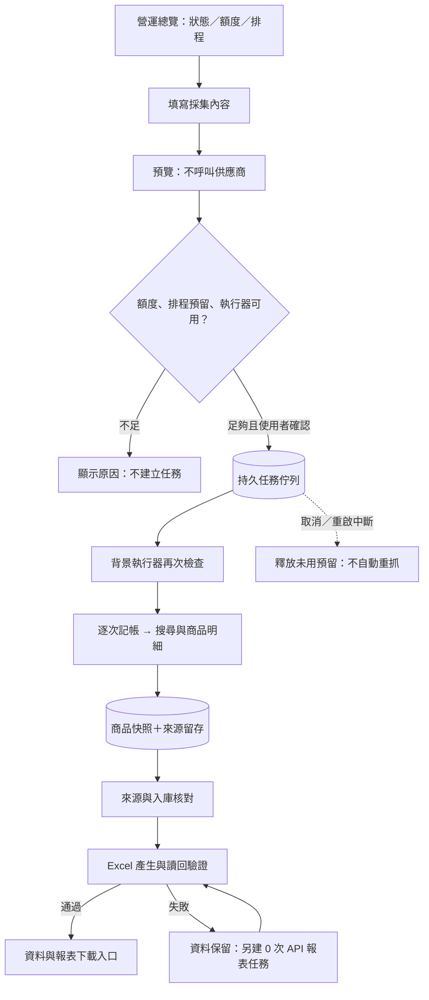

# V8 本機營運中心：操作、驗證與 V10 路線

[目前進度圖](progress-20261006.svg) · [本機狀態驗證](V8_LOCAL_STATUS_20261006.json)

更新：2026-10-06。V8.1 已改用 [Python 獨立排程及 XLSX 引擎](PYTHON_SCHEDULER.md)，不需開啟 Codex；目前 Mac 已啟用，跨平台開機常駐仍待實機驗證。適用於內部 1–5 人、免費額度優先的本機試點。V7／V8 已實作；V9／V10 也已完成本機版，詳見 [排程管理與報表中心](OPERATIONS_V9_V10.md)。以下保留 V8 功能及驗證紀錄。未新增付費服務、雲端部署或自動擴大採集範圍。

## 開始使用

入口：[營運總覽](http://127.0.0.1:8012/?source=rapidapi)。不需要回到聊天才能操作；網頁確認後，由本機背景執行器處理。Mac 需登入且保持喚醒。

1. 首頁看「需要處理」、背景執行器、已取得商品、下一次採集。
2. 「額度與未來安排」分開顯示平台每日限制、試點累計限制，以及供應商最近觀測估計。供應商數字附觀測時間，不宣稱是帳號即時餘額；重置時間未留存就明說未知。
3. 「過去與未來排程」看日期、分類、實際批次及已驗證每日 Excel。排程已載入只代表設定一致，不代表採集成功。當日超過採集／報表時間 15 分鐘仍無結果時提示；過去日期漏跑不補抓。
4. 按「立即採集」，選真實或模擬來源，填分類、關鍵字及 1–2 件商品。先「預覽用量」，檢查通過後再「確認建立背景任務」。預覽不呼叫供應商；未確認不排隊。
5. 任務明細看搜尋、明細、保存與對帳、報表、完成六步，以及每一步回報時間、實際記帳次數、資料與 Excel 入口。任務進行時每 5 秒刷新；關閉頁面不會取消。
6. 排隊可取消；執行中可要求停止後續工作。已送出請求和正在產生的報表可能先完成，已記帳用量不退回。
7. 如果顯示「資料已取得，報表待處理」，按「重產報表（0 次 API）」。只讀已保存資料，不重新抓商品。

返回調整保留分類、關鍵字和商品數；表單頁不自動刷新，避免輸入丟失。既有商品、每期報表、取樣分析、來源查驗及設定中心入口保留。歷史來源對帳頁改為 `/snapshot`；舊的 `/?source=...&run_id=...` 會導到相同批次。

## 已交付功能與界線

| 區塊 | V8 行為 | 界線 |
| --- | --- | --- |
| 營運總覽 | 現況、過去批次、未來排程、告警與資料入口 | 本機回報；不宣稱全天候雲端可用 |
| 雙重額度 | 平台帳本 + 供應商最近觀測，排隊／未來排程預留 | 平台累計上限不是 RapidAPI 月額度；帳號其他使用不會即時同步 |
| 網站任務 | 預覽、確認、持久佇列、進度、取消、歷程 | 每個來源同時只允許一個未完成採集；待處理任務上限 20 |
| 新採集 | US 市場、第一頁、每批最多 2 件明細，最多 3 次請求 | 不額外取完整評論頁，不代表完整市場 |
| 評論及評價 | 明細有提供時沿用 V6 的原文、星等、日期、評價數、分布 | 來源缺值維持未提供；不新增人工／AI 評論判斷 |
| 報表 | 完成採集後產生累計 XLSX，讀回驗證後開放下載 | 包含同來源截至此批次的成功觀測，不能誤認為全是新採商品 |
| 報表重產 | 新任務、新檔名、0 次 API，不覆寫舊檔 | 從已存資料重產；舊核對與批次保留 |
| 任務復原 | 重新啟動後將不確定執行中任務標為中斷／資料已取得 | 不自動重送任何可能已扣額度的請求 |
| 排程 | Python 常駐排程、工作紀錄及近期回報；10:00 採集／10:10 報表 | V9 已提供網頁編輯、預覽及版本保存；無自動擴量或補抓，原計畫仍於 10/08 結束 |
| 金鑰設定 | 沿用安全互動式設定與「設定中心」狀態 | 網頁不回傳金鑰，並未新增瀏覽器保存密鑰或多人登入 |

## 資料與任務流程

## 額度保護

- 預覽、確認、執行前都檢查設定、平台用量、已排隊任務與原計畫。
- 每次請求先在資料庫記帳再呼叫供應商。逾時、失敗、程序突然停止仍保留已消耗次數；未用任務預留在終止時釋放。
- 手動任務必須留下原計畫剩餘總次數；當天未執行排程也有每日預留。例如每日上限 5、當日排程預留 3，手動最多只能再使用 2 次。
- 平台每日帳本採 UTC，下一次台灣時間 08:00 重置；試點 30 次是此資料庫累計上限，不隨每日／每月自動歸零。
- 現有金鑰沒有供應商觀測時，網頁真實採集會阻擋。須先核對訂閱與完成既有有限量初次測試；不可將未知當成無限額度，也不可因網頁阻擋而任意提高平台上限。
- CLI、排程、網站 worker 共用跨程序採集鎖；其他採集正在執行時拒絕新的重疊採集。CLI 額度檢查同樣扣除網站已預留次數。
- 相同確認表單重複提交導向同一個任務，不重複採集。確認有效期為 5 分鐘，額度／計畫／設定變更時要求重新預覽。

## 本機架構與紀錄

本版採最小本機架構：既有 FastAPI + SQLite、新增常駐 task worker 與四張加法資料表。未引進 Redis、Celery 或外部付費佇列。

| 資料表 | 用途 |
| --- | --- |
| `operation_tasks` | 任務內容、狀態、尚未消耗預留、批次關聯、取消意圖與時間 |
| `operation_task_events` | 排隊、階段、停止與完成的逐步回報 |
| `operation_worker_state` | 每 5 秒的背景執行器心跳；超過 30 秒視為未連線 |
| `operation_reports` | 任務 → 來源／截止批次 → 報表路徑／SHA-256／格式版本 |

背景服務：`com.woobe.gummy.tasks`，登入時啟動、退出後重新啟動。原 `com.woobe.gummy.ui` 提供 8012；每日計畫改由 `com.woobe.gummy.scheduler` 啟動 Python 常駐程序；原採集／報表日曆工作已卸載並持續停用，安裝檔保留。Codex 跟進已刪除。任務服務日誌在 `data/task-worker.stdout.log`、`data/task-worker.stderr.log`。心跳只證明近期程序有回報，任務完成仍以結果與來源對帳為準。

安全寫入只註冊於本機模式；寫入要求 loopback 連線與 Host、同站 Origin／Fetch Metadata、簽章表單及 HttpOnly／SameSite=Strict Cookie。表單限 8 KiB，來源／商品數／批次範圍驗證；金鑰、設定綁定雜湊與供應商原始錯誤內容不輸出。既有 Bearer 驗證仍適用。下載只允許伺服器選定的 `exports/operations/<task_id>.xlsx`，核對路徑、符號連結、資料庫檔案雜湊與驗證紀錄。這是本機試點，不是已具多人身分驗證的正式網站。

## 介面及 API

| 方法／路徑 | 行為 |
| --- | --- |
| `GET /` | 營運總覽；30 秒自動刷新 |
| `GET /tasks` | 網站任務、原排程、歷史採集與報表入口 |
| `GET /tasks/new` | 有界採集或現有批次報表表單 |
| `POST /tasks/preview` | 驗證表單、預覽用量；無供應商 I/O |
| `POST /tasks/confirm` | 確認狀態一致後新增任務，303 導向明細 |
| `GET /tasks/{id}` | 任務、階段與請求結果；進行中 5 秒刷新 |
| `POST /tasks/{id}/cancel` | 取消排隊或要求停止後續工作 |
| `GET /v1/operations` | 同一份營運狀態 JSON |
| `GET /v1/operations/tasks/{id}` | 來源隔離且排除私人設定的任務 JSON |
| `GET /v1/operations/reports/{id}.xlsx` | 通過核對才提供 Excel |
| `GET /snapshot` | 保留既有批次成果與來源對帳頁 |

## 驗收結果

- 任務測試覆蓋唯讀預覽、同表單重複提交、來源隔離、工作階段／簽章／過期、跨站／非本機拒絕、Bearer、表單大小與格式、額度變動、排程預留、CLI 相容、取消、重啟不重送、報表失敗保留資料、非法下載路徑，以及返回保留草稿。
- 模擬 RapidAPI transport 證明兩件商品只呼叫一次搜尋與兩次明細；取消在搜尋後只保留 1 次記帳，後續明細未呼叫。報表重產任務記帳 0 次。
- 隔離瀏覽器實際建立模擬任務 `cd72f622102a46f326be0c5f19b8151f`，完成兩件商品、來源核對、v3 XLSX 與 manifest 驗證，成功下載。該任務只寫入 `.work/v8-browser.db`，API 用量 0，未混入真實資料。
- 實際 8012 真實採集預覽，平台日用量不足時按鈕停用；沒有新增真實採集任務。
- 舊九張資料表逐列與開發前 SQLite 備份一致；原兩份每日 XLSX 及計畫雜湊一致。真實 API 帳本仍 17 次。
- 本次沒有實際新增 RapidAPI 呼叫。網頁真實採集的網路契約以 mocks 驗證；下次有可用額度且使用者確認才會執行。PostgreSQL 本版新增任務表／鎖仍需獨立整合驗證。

驗證截圖：[桌面總覽](ui-v8-operations-desktop-20261006.png)、[不足額度預覽](ui-v8-budget-block-20261006.png)、[隔離任務成功](ui-v8-task-success-20261006.png)。最新整體測試與手機截圖以 [VALIDATION.md](VALIDATION.md) 的 V8 段落為準。

## V8～V10 功能階段

| 階段 | 接續區段 | 可驗收結果 |
| --- | --- | --- |
| V8：本版已完成 | 看狀態、確認小量採集、追蹤任務、資料／報表追溯 | 離開聊天後仍可在網站操作，額度不足不能採集，報表可零 API 重產 |
| V9：本機已完成 | 排程管理：有限期計畫、分類／日期／商品數、暫停／啟用、用量預估 | 先比較變更前後、預估全部用量，再明確套用；同步驗證 Python 採集與報表時間，失敗保留原設定 |
| V10：本機已完成 | 統一報表中心：每天／每期、資料截止批次、產生版本、來源覆蓋、任務關聯、下載與重產 | 查詢、商品明細、統計與下載使用同一固定資料範圍；原檔不可被重產覆寫；舊報表可按原版本核對 |

正式多人／雲端上線前另行確定資料敏感度與地緣要求，再處理登入、角色授權、秘密管理、備份、雲端任務排程、可用性與費用。V10 功能完成不等同已部署正式環境。現階段保持零新增外部服務成本，擴大採集仍受訂閱與試點額度限制。
