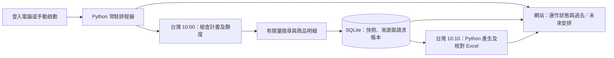

# V8.1：不依賴 Codex 的 Python 排程

> 更新：循環規則啟用後，由同一 Python 排程器派發背景任務，採集完成後直接產報，不再使用原逐日清單或固定產報時間。詳見 [循環排程說明](RECURRING_SCHEDULES.md)。以下保留原試跑模式的設定參考。

更新：2026-10-06。已在目前 Mac 安裝並啟用；適用於內部 1–5 人、免費額度優先的本機 SQLite 試點。當次查驗結果見 [本機驗證紀錄](PYTHON_SCHEDULER_LOCAL_STATUS_20261006.json)。

## 現在由誰執行？

原先是 macOS 的兩個日曆工作啟動 Python 採集與報表，Codex 另做事後檢查；採集本身並非 GPT 在執行。不過舊 Excel 產生器使用 Codex 附帶的試算表環境，因此搬機仍有相依。

現在時間判斷、工作紀錄、採集、Excel 產生及來源讀回驗證都在 Python 內完成。Excel 使用一般 Python 套件 openpyxl，不需要 Node、Codex 或 GPT。網站只讀取排程器的近期回報與資料庫結果。



macOS 仍協助在登入時啟動 Python 程序，**每日幾點執行由 Python 決定**。已載入 `com.woobe.gummy.scheduler`；舊採集與報表日曆工作已卸載並停用。Codex 的 `gummy` 跟進已刪除，不必開啟 Codex。

目前維持原計畫：2026-10-04 至 10-08，10:00 採集、10:10 報表，時區固定 `Asia/Taipei`。今天 run10 已存在，切換時只核對重用，未重新發送請求。接續為 10-07 數位扭力扳手、10-08 鐵皮剪；10-08 之後程序可繼續回報，但不再採集，新增計畫須重新確認範圍及用量。

## 查看與啟動

目前這台 Mac 已有背景程序，**不需再啟動第二份**。下列檢查只讀設定和狀態，不會採集：

```sh
cd /Users/eddiechu/Program/Rapid
.venv/bin/gummy scheduler --config python-scheduler.json --check
```

另一台電腦完成安裝後，最簡單的啟動方式：

```sh
.venv/bin/gummy scheduler --config python-scheduler.json
```

終端機需保持開啟。`Ctrl+C` 安全停止；可再啟動，相同已完成工作不重抓。`--once` 是執行當下到期工作的模式，**可能呼叫 RapidAPI**，不能當作唯讀檢查。

網站仍以 `.venv/bin/gummy serve --port 8012` 啟動；網站的手動採集另由 `.venv/bin/gummy task-worker` 執行。三個程序分工：排程器處理每日計畫，任務執行器處理網頁已確認的任務，網站呈現資訊。它們共用資料庫額度與採集鎖。

## 更換排程時間

V9 已提供 [網頁排程管理](http://127.0.0.1:8012/schedules)。調整時間與明天起的安排，先預覽前後差異及請求用量，再確認保存版本。Python 讀取已核准的 DB 版本，不需停止或修改原設定檔；新時間與商品安排從明天生效，暫停／啟用在下一次檢查採用。完整規則與跨日暫停處理見 [V9／V10 操作說明](OPERATIONS_V9_V10.md)。沒有依額度自動擴量。

基礎來源仍是 [python-scheduler.json](../python-scheduler.json) 與原計畫，兩者維持固定雜湊。不要在程序運作中直接改檔，亦不要將基礎檔修改當成網站版本變更；無法核對時會停止。網站版本保存在資料庫，搬機須一併保留一致 DB、基礎設定與原計畫，不能刪除版本或帳本以重試。

目前 Mac 使用既有 `com.woobe.gummy.scheduler`；沒有新增另一份排程。原 10:00／10:10 時間與 10/08 結束日保留。

## 換電腦：依序完成

### 1. 停止舊電腦並打包

現在提供一個指令交接工具，請依 [README：搬移與交接](../README.md#搬移與交接保留現有商品報表與排程) 完成舊機停用、打包、新機準備與驗收。正式交接先停止派發，等工作完成，再停止任務執行器；不要讓兩台同時用同一帳號採集。

```sh
.venv/bin/python scripts/transfer.py export
```

交付工具產生的 ZIP 即可，已包含一致的 SQLite 快照、規則／歷史、原計畫與設定、排程狀態、報表及驗證檔；不需要另外手動搬 DB。原機 `.env`、金鑰、`.venv`、舊電腦安裝的自動啟動服務不打包。帳本不重設。

### 2. 新電腦建立環境並準備資料

在全新解壓資料夾，以 Python 3.12 以上建立環境；以下為 macOS／Linux：

```sh
python3 -m venv .venv
.venv/bin/python -m pip install -c requirements.lock.txt -e .
.venv/bin/python scripts/transfer.py prepare
.venv/bin/gummy quota
.venv/bin/gummy serve --port 8012
```

準備工具核對內容、修正報表位置，產生沒有金鑰的 `.env`，不啟動採集。先從網站核對商品、報表下載及排程歷史，再依 README 安全設定接收端自己的金鑰並執行唯讀排程檢查。API 金鑰不要放在交接 ZIP；新機須自行確認免費訂閱及帳號額度。Windows 指令及常見錯誤也列在 README。

### 3. 先前景測試，再設定開機啟動

先確認 `--check` 的計畫與 10:00／10:10 相符。停止舊機後才啟動新機排程。前景啟動會處理當日到期工作：既有成功資料會重用；若仍在允許時間且當日尚未採集，可能消耗正常採集額度。

macOS 登入自動啟動：在新機重新產生安裝檔，確定沒有另一份排程程序後安裝。以下不可在目前已安裝的 Mac 重複執行：

```sh
.venv/bin/python scripts/scheduler_startup.py --platform macos --config python-scheduler.json --output data/com.woobe.gummy.scheduler.plist
mkdir -p "$HOME/Library/LaunchAgents"
cp data/com.woobe.gummy.scheduler.plist "$HOME/Library/LaunchAgents/com.woobe.gummy.scheduler.plist"
chmod 600 "$HOME/Library/LaunchAgents/com.woobe.gummy.scheduler.plist"
launchctl bootstrap "gui/$(id -u)" "$HOME/Library/LaunchAgents/com.woobe.gummy.scheduler.plist"
```

Linux 可產生使用者 systemd 工作後安裝；目前只有設定檔產生功能，尚未在 Linux 實機驗證：

```sh
.venv/bin/python scripts/scheduler_startup.py --platform linux --config python-scheduler.json --output data/gummy-scheduler.service
mkdir -p "$HOME/.config/systemd/user"
cp data/gummy-scheduler.service "$HOME/.config/systemd/user/"
systemctl --user daemon-reload
systemctl --user enable --now gummy-scheduler.service
```

預設依賴使用者登入，未設定離線常駐或伺服器部署。路徑改變後需重新產生服務檔。

Windows 可使用一般 Python 與 PowerShell，前景啟動如下；檔案鎖已提供 Windows 實作，但尚未完成 Windows 實機驗證：

```powershell
py -3.12 -m venv .venv
.venv\Scripts\python.exe -m pip install -c requirements.lock.txt -e .
.venv\Scripts\python.exe -m gummy scheduler --config python-scheduler.json --check
.venv\Scripts\python.exe -m gummy scheduler --config python-scheduler.json
```

登入自動啟動可在 Windows「工作排程器」新增目前使用者的工作：觸發條件選登入，程式填新專案 `.venv\Scripts\python.exe`，引數填 `-m gummy scheduler --config "完整路徑\python-scheduler.json"`，開始位置填專案完整路徑；不要使用系統管理員權限。此設定仍需在目標 Windows 上驗證，不能宣稱已完成跨平台上線。

## 運作與失敗規則

- 電腦需開機、程序需運作；不保證睡眠、關機或斷線仍能採集。
- 採集只允許當日 10:00 起 15 分鐘內；醒來太晚會記錄漏跑，不補抓歷史日期。已成功當日資料則直接核對重用。
- 每批最多 2 件是設定上的取樣限制，通常用 1 次搜尋 + 最多 2 次商品明細，共最多 3 次請求；不是「兩件等於兩次 API」。評論只保留明細已提供內容，不另取完整評論頁。
- 每次請求先記帳，失敗／逾時仍保留用量。工作先保存執行意圖；程序意外停止後會標為中斷，不自動重送可能已扣額度的請求。
- 預設本機每日上限 5 次（UTC 日、台灣 08:00 重置）、此 DB 累計 30 次；與 RapidAPI 帳號即時餘額不同，搬機不得重設。供應商最近觀測估計另行顯示時間。
- 前期報表及來源核對通過才繼續下一批。報表失敗保留資料，不重新採集；補產只能從已存資料另輸出新檔。已存在檔案拒絕覆寫。
- 已完成工作的狀態寫入 `data/python-scheduler-state.json`。不要刪除此檔來重試。中斷／失敗工作須先查 DB、來源及用量，人工決定處理。
- Excel 保留來源值、框線、格式與人工 K–M 欄。新報表會核對完整資料列及拒絕公式；人工欄只承接已通過讀回核對的前期檔，不新增 AI 評論。

## 查看執行狀態

首頁顯示「Python 獨立排程器」、最後回報、每日時間及實際歷史結果。每 10 秒回報一次，超過 40 秒無有效回報便顯示程序未運作；近期回報不等於採集已成功，仍以批次及來源核對為準。

日誌為 `data/python-scheduler.stdout.log`、`data/python-scheduler.stderr.log`，工作錯誤只保存類型代碼，避免把例外中的密鑰／網址細節寫入狀態。設定檔與狀態不包含 API token。網站仍使用原有本機綁定與驗證設定，不因本次更改而對外公開。

執行純 Python 報表的指令：

```sh
.venv/bin/gummy export-xlsx --source rapidapi --run-id 10 --output exports/another-name.xlsx
```

它不呼叫供應商，拒絕覆寫同名檔；若要承接人工欄，額外指定 `--review-workbook`。部署後的新每日報表及網站報表任務已預設使用 Python 引擎。舊 JavaScript 工具保留供既有工具使用，並非新排程的必要依賴。

## 驗證界線

V8.1 完整測試 170 項通過、1 項因未啟動 PostgreSQL 略過；Ruff 檢查與套件相依檢查通過。已驗證目前 Mac 常駐啟動、近期回報、當日重用、既有三天報表相容性，以及隔離資料中的正常到時採集、漏跑、失敗不重試、重啟不重複、無 Node/Codex 報表、人工欄承接及公式拒絕。從 run10 已存資料產生的 15 頁 Python XLSX 也由另一個讀回工具核對通過，並檢查所有分頁的框線、文字及數字呈現。

本次切換前後帳本維持 20/30、UTC 當日 3/5，原每日 XLSX 雜湊保持一致，沒有新增供應商請求。明天 Python 到時觸發的真實採集仍待實際時間驗證；Windows／Linux 開機常駐仍待各平台實機驗證。

V9／V10 新增網頁排程與期間報表的測試及目前結果見 [V10 本機驗證](V10_LOCAL_STATUS_20261006.json)，完整套件更新為 180 項通過、1 項 PostgreSQL 跳過。
