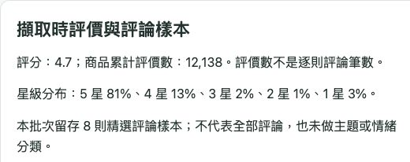

# 真實商品樣本查驗：評價數、星級分布與評論

日期：2026-10-05。使用者已授權樣本檢查；本輪使用現有免費方案，建立一個獨立測試批次，不補跑歷史日期。

## 樣本與請求範圍

- `run_id=9`，run-key `sample-fields-20261005-01`，狀態 `SUCCEEDED`，1 件真實商品。US 搜尋 `1/2 inch drive torque wrench`，搜尋分類為扭力扳手 1/2。
- 恰為 1 次搜尋、1 次商品明細，共 2 次成功請求；沒有另呼叫 Product Reviews、重試或升級付費方案。採集前已建立並驗證 SQLite 備份。
- ASIN `B07MP1Q3W8`，LEXIVON LX-183，擷取時間 2026-10-05 13:53 台灣時間。
- 既有 run_id=5、6、7、8 的來源與入庫離線對帳均 PASS；舊 run_id=3 的兩筆缺來源證據維持 INCOMPLETE。

## 實際取得與核對結果

| 資料 | 本批取得 | 查驗結果與限制 |
|---|---|---|
| 商品、品牌、型號 | LEXIVON LX-183、1/2 吋扭力扳手 | Amazon 當前選取商品與搜尋分類相符 |
| 評分 | 4.7 | 與當前 Amazon 商品頁相符 |
| 商品累計評分數 | 12,138 | 與當前 Amazon 全球評分數相符；不是有文字評論的筆數 |
| 五級星等百分比 | 5→1 星：81%、13%、2%、1%、3% | 與 Amazon 評價區相符，合計 100%；不是各星精確筆數 |
| 精選評論樣本 | 8 則，各有 ID、標題、內文、星等、日期 | 8 個 ID 不重複，欄位已留存及匯出；Amazon 逐則評論需登入，本輪未逐則獨立核對全文 |
| 價格 | 44.97 USD | 來源與入庫相符；瀏覽器配送台灣／台幣視角不同，未完成相同地區下的獨立價格核對 |
| 材質、顏色 | chromium molybdenum steel、black | 來源與入庫相符，商品頁亦顯示鉻鉬鋼、黑色 |
| 制式原文 | `Measurement Standard = Metric, SAE` | 保存在來源附加欄位；尚未自動映射成已確認的 `measurement_system` |
| 銷售資訊 | 供應商購買提示文字 | 不是精確件數或成交額，沒有據此生成月銷額、`sum_sales` 或 `score_rank` |

Amazon 查驗頁：[B07MP1Q3W8](https://www.amazon.com/dp/B07MP1Q3W8)。供應商欄位參考：[Real-Time Amazon Data](https://www.openwebninja.com/api/real-time-amazon-data)。上述網頁核對是在本輪實際瀏覽器進行；並未使用搜尋快取數字作為當前商品頁證據。

評論只選取同 ASIN、欄位完整且長度符合限制的最多 8 則；不保存作者名稱／帳號／頭像或完整供應商回應。同 ASIN 仍可能含不同變體的評論，不能稱為本型號的完整評論母體。內文可能包含作者自行寫入的個人資訊，正式上雲前仍需設定保留期限與存取權限。

## 網站與 Excel 已完成

1. [本機樣本核對頁](http://127.0.0.1:8012/reviews/9/B07MP1Q3W8?source=rapidapi) 現在顯示評分、評價數、星級分布及 8 則評論。修正評論中 HTML 字元實體的重複顯示；畫面解碼一次後再跳脫，資料庫來源原文保持不變。
2. 以「Codex 樣本查驗」留下版本 1 紀錄，分類與來源一致性為符合，備註保留美元價格及評論全文未獨立核對的限制。這是使用者授權的代查紀錄，不是使用者本人驗收；網站其餘 9 筆觀測仍待核對。Excel 對帳索引 K–M 與網站紀錄分開，前者全部 10 筆仍待確認。
3. 產生獨立 [樣本查驗版 Excel](../outputs/01a0f6da-7287-7fb1-9c31-d4744b5f5144/amazon-sample-check-20261005-run9.xlsx)：截至批次 9 的 6 個成功真實批次、10 筆觀測、8 個 ASIN；12 個分頁，包含來源附加欄位及網站核對。附加欄位共 122 列，其中 40 列為 8 則評論的 5 個欄位、5 列為星級百分比。各商品分類頁 I 欄繼續保留累計評價數。
4. 獨立讀回驗證 PASS：10 筆觀測、23 個分類列、5 個分類頁、11 組規格組合、10 筆來源對照、122 筆附加欄位、10 筆網站核對列（其中 1 筆有填寫）。另以只讀試算表工具核對評論 ID、星等百分比合計、備註及無公式；12 頁與長評論／長備註畫面均完成檢視。這不是 Microsoft Excel／Numbers 原生開啟驗收。
5. 調整長評論與查驗備註的換行列高，避免內文被遮住。針對評論顯示、網站核對、附加欄位匯出的測試為 9 passed；Ruff、格式及報表程式語法檢查通過。

新 Excel SHA-256：`0305a10d432441c073e3fbbd5b48ca6af3a83400b8cda78a2be4d59eee44ea2b`。原 10-05 排程報表 `handtools-20261004-08-20261005-run8.xlsx` 保持原檔，SHA-256 仍為 `c0ad6d14eff8b6fba46f1f867a5ed0ff2e646433d9fa23d3e903f51b03b7ac8d`。

## 免費額度與下一步

本機帳本現在為 **累計 17/30、UTC 2026-10-05 當日 5/5**；今日停止外部採集。供應商最後回應標頭估計剩餘 84，觀測時間 2026-10-05 05:53:04 UTC；這不是目前帳號餘額，其他應用也可能消耗。

原 10-06 至 10-08 排程保持不變，唯讀驗證為 READY、無漏跑或衝突，最多再用 9 次；全部成功且沒有額外用量時，本機累計最多 26/30，餘 4 次。Mac 須開機、登入並保持喚醒才能準時執行。新增批次 9 是可追溯的商品快照，後續累計報表會自然包含它；不能將同 ASIN 多期的累計評分數直接相加。

開發順序：先完成現有排程交接；再從已存資料製作「每期 × 分類 × 價格帶／品牌」取樣統計，明確選定期間及每個 ASIN 的最新觀測，區分評分數與文字評論樣本數。制式等別名映射須保留原值及人工確認狀態；評論主題／正負向先人工標註少量樣本，不將 8 則精選評論推論為完整市場意見分布。銷售額與原範例 `score_rank` 等待可驗證來源。
