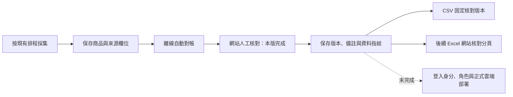
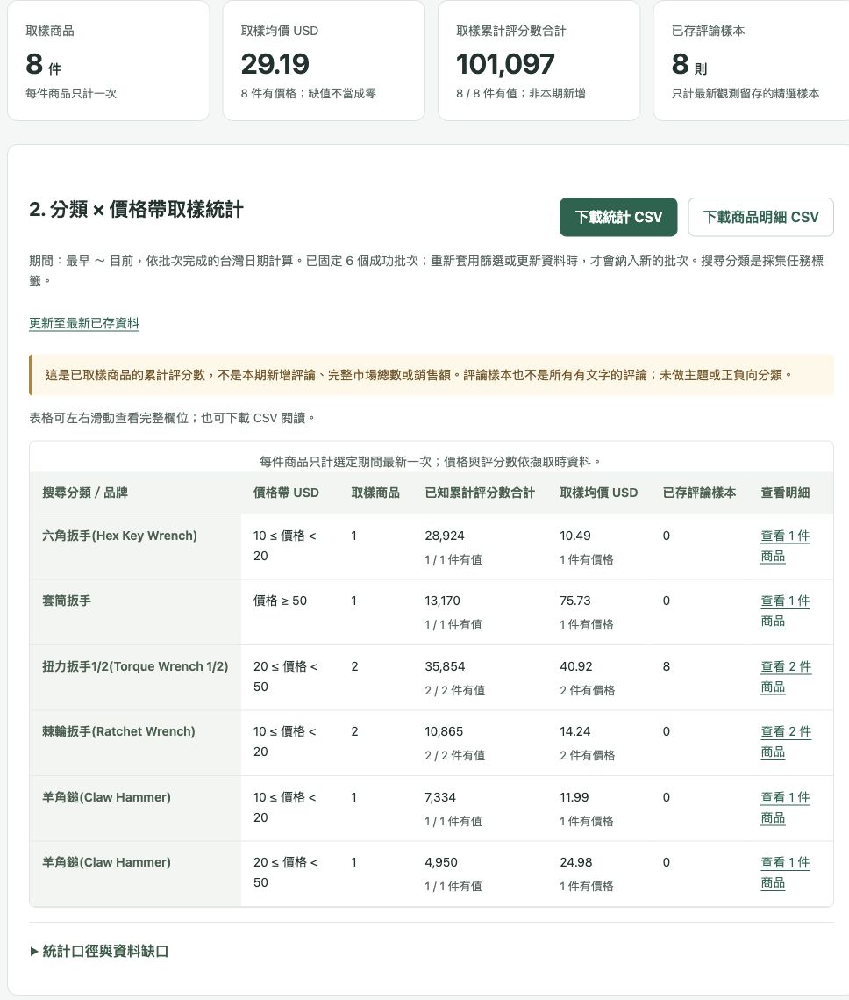
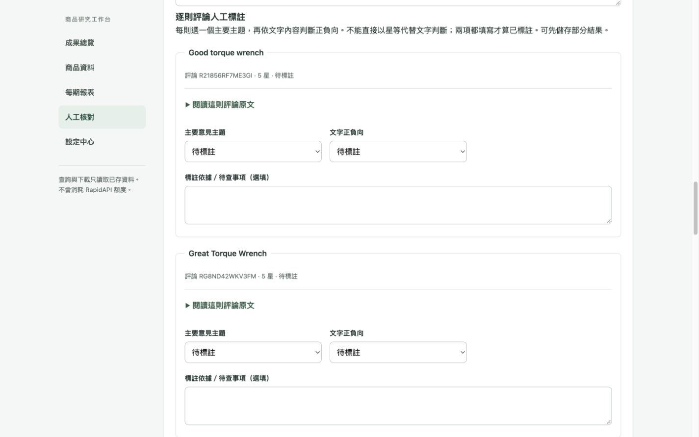
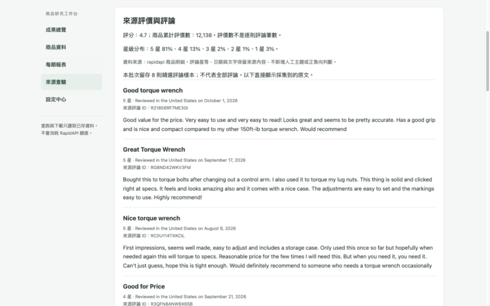

# 本機查驗畫面與多工作表報表

**目前版本：V8（2026-10-06）**。新增營運總覽、任務與排程、預覽確認採集、背景進度與已驗證報表下載，請見 [V8 操作與 V10 路線](OPERATIONS_V8.md)。評論以 V6 採集來源為基準；以下早期人工評論功能只作歷程，已停止新寫入。

## 2026-10-05 第三版：網站人工核對與核對結果匯出

**入口：<http://127.0.0.1:8012/reviews?source=rapidapi>**。以下為目前操作方式；後面的第二版與早期紀錄保留作為歷程。

### 你現在可以做什麼

1. 在「人工核對」按「選擇要核對的商品」可跳至清單；亦可依名稱／ASIN、搜尋分類及進度篩選，按「開始／繼續核對」。每個採集批次獨立計算，不把昨天核對過的 ASIN 自動套到今天。
2. 同頁比對採集時留存的來源欄位與入庫資料。現時 Amazon 商品頁只作參考，可能已改價；「程式對帳一致」不代表人工驗收完成。
3. 填「分類判斷」「來源與入庫核對」、填寫人名稱及備註，再按「儲存核對結果」。四種判斷為待確認、符合、不符合、無法確認。缺少來源證據或自動對帳有差異時，來源欄不能選符合。
4. 回到清單，可查看待核對／核對中／已填寫／資料變更需重核。「兩項判斷已填」包含不符合及無法確認，**不代表兩项都通過**。
5. 在清單按「匯出含核對結果的 CSV」，預覽後下載。也可以在商品資料的匯出預覽勾選網站核對欄位。



### 修改、衝突與來源變更

- 結果綁定 `(run_id, ASIN)`，資料來源透過成功批次驗證。保存的是人工判斷；不會修改採集標題、價格、規格或來源。
- 每次儲存都新增版本，保留填寫人、UTC 時間與備註；畫面顯示台灣時間。填寫人是**自填名稱，尚非登入驗證的身分**。
- 兩份表單同時編輯時，後存者收到 409 提醒，保留草稿並顯示最新結果；使用者比較後再次儲存，才新增下一版。
- 來源／商品／分類參數改變時，資料指紋會不符，畫面標示需重核；舊結論留在歷程。過期表單不能直接存入，新表單的判斷重設為待確認。
- 應用程式不提供刪除或改寫歷程的功能，但本機資料庫擁有者仍能直接修改 SQLite。這不是數位簽章或防竄改稽核系統。

### CSV 與 Excel 如何保留結果

| 位置 | 內容與規則 |
| --- | --- |
| 網站資料庫 | 網站核對結果的保存位置；新批次不沿用舊結論 |
| 網站 CSV | 可帶核對狀態、分類、來源、備註、填寫人、版本及時間。勾選任一核對欄時必帶狀態、版本、時間，避免輸出舊結論卻遺漏需重核提示 |
| 匯出範圍 | 同時固定成功批次清單 `snapshot` 與本機核對事件上限 `review_snapshot`；預覽後的新修改不混入同次下載。重新套用篩選或更新資料會取最新版本 |
| 後續累計 Excel 的「網站核對」 | 選定批次有網站核對紀錄時新增此分頁，逐筆附狀態與版本；未核對列保持待核對。只是匯出快照，修改請回網站 |
| 既有「對帳索引」K–M | 保留原本 Excel 手填與跨期承接方式。**不自動匯入網站，也不被網站結果覆寫**；兩處若判斷不同，需由人員比較 |
| 舊報表重新驗證 | `.xlsx.verified.json` 保存 `web_review_snapshot`，按原版本讀回；網站後續修改不使舊報表憑空換成新結論。缺少相應驗證紀錄時，不宣稱已驗證網站核對分頁 |

原始商品欄位仍是已存採集快照；批次及核對版本鎖定不代表整個資料庫不可被管理者修改。CSV、XLSX 文字維持公式注入防護。較長備註完整存於儲存格，可在 Excel 展開儲存格查看。

### 本機寫入保護與資料表

- 寫入介面僅註冊於 `APP_ENV=local`。核對表單要求連線位址與 Host 為本機回環；正式雲端模式沒有這些寫入路由。不要對外轉發本機埠。
- POST 檢查同站 Origin／Fetch Metadata，並驗證綁定 Cookie、來源、商品、版本、資料指紋及一小時期限的 HMAC 表單 Token。Cookie 為 HttpOnly、SameSite=Strict；既有 API Bearer 驗證仍適用。
- HTML 採用 `Referrer-Policy: same-origin`：瀏覽器可保留本站 POST 的 Origin，外連不送 referrer。仍拒絕 `Origin: null` 及跨站來源；沒有為通過瀏覽器測試而放行空來源。
- 名稱最多 80 字、備註最多 2,000 字、表單最多 32 KiB，限制欄位與列舉值；輸出進行 HTML escape。存檔失敗時不會留下只有版本增加而沒有事件的狀態。
- 加法遷移 `001` 建立 `human_review_heads`、`human_review_events`；不變更既有採集表。版本更新與事件新增在同一交易，版本以 compare-and-swap 防覆寫；事件的批次／ASIN／版本具唯一約束。
- 開發前已完成 SQLite 線上備份與完整性檢查：`data/backups/gummy-20261004T162230Z.sqlite3`。網站重新啟動時套用這個可重複執行的本機加法遷移。雲端遷移與多人身分授權另行驗證。

### 介面與驗證

- `GET /reviews`：核對清單、搜尋、分類、進度及分頁。
- `GET /reviews/{run_id}/{asin}?source=rapidapi`：來源對照、填寫表單與修改歷程。
- `POST /reviews/{run_id}/{asin}?source=rapidapi`：本機表單存檔；成功以 303 回到詳情，衝突 409、內容不符 422。
- 商品頁的「查看來源」現在進入該筆核對頁；成果總覽的舊人工數字明確標成 Excel 進度，網站進度請到人工核對清單。
- 本版全套測試 **111 passed、1 skipped**；略過項目為未設定 PostgreSQL 的整合測試。Ruff 檢查與修改檔案格式檢查通過，套件相依檢查通過。
- 測試涵蓋同時更新、版本不符、來源變更、缺證據、交易失敗回滾、來源隔離、本機／Host／Bearer／CSRF 拒絕、HTML escape、CSV 公式前綴與固定版本、Excel 讀回及舊版本保留。
- 瀏覽器以獨立模擬資料庫完成存檔、第二版、雙表單衝突與草稿保留；375／768／1440 寬度無整頁水平溢出。測試結果不寫入真實商品核對欄。
- 更新後已確認本機 8012 的核對清單顯示 7 筆真實觀測、0 筆網站人工核對。6 張既有資料表逐列與開發前備份一致；API 呼叫帳本仍為 12 筆。既有 run 7 XLSX 的 SHA-256 未變，離線讀回驗證通過。
- 本次沒有呼叫 RapidAPI、修改真實金鑰或採集排程，也沒有部署雲端。Google 登入、管理員角色、網頁金鑰寫入及 Excel 人工結論匯入仍是後續階段。

## 2026-10-04 第二版：商品查詢、每期資料與設定中心

### 使用入口

- 商品資料：<http://127.0.0.1:8012/products?source=rapidapi>
- 每期報表：<http://127.0.0.1:8012/periods?source=rapidapi>
- 設定中心：<http://127.0.0.1:8012/settings>

本版沿用 FastAPI、本機 SQLite 與既有採集程序，不新增付費服務。所有網頁查詢、來源對帳和下載只使用已存資料；不會呼叫 RapidAPI。現有每日採集、報表排程、額度與原始 XLSX 不因本次開發而變更。

### 本版完成的操作流程

1. **商品資料**：輸入名稱、ASIN 或品牌，選擇搜尋分類及顯示方式，按「套用篩選」。更多篩選可選日期、品牌、材質、結構化制式、價格與排序。手機可直接按「查看 N 筆查詢結果」跳至結果，寬表格只在表格容器內捲動。
2. **看歷史**：「每件商品最新一筆」只列一筆；「全部歷史採集紀錄」保留同一 ASIN 的不同批次。每筆都顯示採集時間、搜尋分類、價格及來源證據狀態。「查看來源」會進入正確批次的對帳區。
3. **每期報表**：選開始／結束日期，或按「最近 7 天」「本月」。查看該期間完成的成功批次、筆數與不重複商品數。失敗和漏跑仍到成果總覽的採集排程檢查。
4. **匯出**：按「預覽與匯出」或「匯出期間資料」，確認筆數與範圍，選擇欄位後下載 CSV。下載包含所有符合條件的分頁，不只畫面當頁；保留 UTF-8 BOM 與試算表公式注入防護。預覽表固定顯示摘要欄位，CSV 則依勾選輸出。
5. **既有 Excel**：每期報表頁提供目前計畫中已產生檔案的下載連結。這是截至該批次的累計 Excel 副本，可能包含查詢期間以前的資料；不是重新產生的單日報表。早期未登錄在目前計畫中的手動匯出檔不會被掃描列出。
6. **設定中心**：顯示金鑰是否設定、本機額度、供應商最後觀測估計、最近成功採集、本站存取 Token 狀態與排程狀態。畫面不傳回完整金鑰或金鑰片段。

### 期間及「最新」的精確定義

- 期間依 **成功批次完成時間的 Asia/Taipei 日期** 判定，開始、結束日期皆包含；資料列另外保留原始採集時間。日期不依檔名推測，也不是 UTC 帳本日。
- 最新模式先依資料來源、期間、指定批次與搜尋分類取範圍，再以 `(country, ASIN)` 選出採集時間最新的紀錄；時間相同時以較大的批次 ID 決定。其後才套用價格、品牌、關鍵字及規格條件，避免新價格不符時錯誤找回舊價格。
- 搜尋分類仍是採集任務標籤，不代表人工分類已確認。結構化公制／英制篩選不會把標題候選升格為事實。
- 查詢結果、分頁連結與匯出預覽攜帶成功批次清單 `snapshot`；下載沿用同一清單。之後完成的新批次，包括較小 ID 的延遲批次，都不會混入。初始空範圍用 `0` 表示，之後仍維持空集合。重新套用篩選、更新資料或重新選期間才重新取清單。
- 批次清單固定的是查詢成員，不是數位簽章或資料庫防竄改機制；修改來源內容或分類程式後，不應把重新匯出冒充成不可變的舊報表版本。正式報表版本、檔案索引及簽章屬後續工作。
- 空值仍是未提供；價格篩選排除無價格商品，價格排序把無價格排在最後。查不到商品不代表下架。
- 每次最多處理 500 個批次、10,000 筆觀測；超過時明確要求縮小期間，不截斷後宣稱是完整匯出。商品頁每頁預設 20 筆。
- CSV 固定附帶資料來源、成功批次清單、台灣日期範圍、顯示模式、日期判定方式與完整篩選條件；商品欄位可自行勾選。CSV 未帶入 Excel 人工結論；該結論目前仍儲存在人工工作檔。

### 金鑰設定流程與界線

本版提供安全的本機輸入精靈，尚未提供網頁寫入金鑰。先在設定中心按「設定／更換金鑰」，再於本機終端執行：

```bash
cd /Users/eddiechu/Program/Rapid
.venv/bin/gummy configure-rapidapi
```

依提示輸入兩次金鑰；輸入不顯示，也不接受命令列參數、管線或聊天傳遞。無法隱藏輸入時直接停止；儲存不會測試供應商連線。格式檢查不能證明金鑰有效。

精靈只替換 `.env` 的 `RAPIDAPI_KEY`，保留其他設定與註解；以同目錄暫存檔原子替換、權限 `600`，不留含金鑰的備份或日誌。符號連結、多重硬連結、其他擁有者的檔案均拒絕。失敗保留原設定。已存在的外部環境變數可能覆蓋 `.env`，精靈會拒絕這種模糊情況，避免顯示存好但實際仍用舊值。

若使用本專案已安裝的網站 LaunchAgent，儲存後可以重啟網站程序以更新狀態：

```bash
launchctl kill TERM gui/$(id -u)/com.woobe.gummy.ui
```

此命令只重啟網站；KeepAlive 會再次啟動它，不會觸發採集。每日採集是另外的新程序，會按既有環境設定讀取金鑰。設定中心若發現檔案與網站啟動時載入的值不同，會提示檢查覆蓋來源與重啟。

目前的 `.env` 是擁有者可讀寫的本機檔案，**不是加密秘密管理服務**。共用上線前仍需要管理員登入、伺服器端秘密儲存與金鑰操作稽核；不能把這個本機精靈當作已完成的雲端金鑰管理。

RapidAPI 金鑰負責採集，`GUMMY_API_TOKEN` 是既有共用 API 存取憑證。金鑰儲存不會提高本機 30 次累計／5 次每日上限、不改免費方案確認、不清空額度帳本、不新增或延長排程；供應商撤銷操作仍需到 RapidAPI。Google 登入、角色、對外分權 Token、網頁直接保存金鑰與消耗額度的連線測試未包含於本版。

### 新增介面與實作位置

| 介面 | 用途 |
| --- | --- |
| `GET /products` | 本機商品搜尋、篩選與分頁 |
| `GET /periods` | 本機期間及批次查詢 |
| `GET /exports/preview` | 範圍預覽與欄位選擇 |
| `GET /settings` | 本機設定狀態與安全設定指引 |
| `GET /v1/catalog` | 同一查詢條件的分頁資料與固定批次範圍 |
| `GET /v1/exports/catalog.csv` | 依篩選範圍匯出全部符合列 |
| `GET /v1/exports/workbooks/{run_id}.xlsx` | 只下載目前計畫中指定批次的既有 XLSX |
| `gummy configure-rapidapi` | 本機互動式金鑰設定；無供應商請求 |

所有新業務介面沿用既有 Bearer 保護；設定 Token 後，未提供有效憑證會得到 401。HTML 設定／查詢頁與歷史 XLSX 入口僅在 local 模式註冊。新畫面使用 `no-store`、禁止外部資源、同源表單及禁止框架嵌入；不新增前端腳本、第三方資源或外部套件。XLSX 下載不接受任意路徑，不會缺檔就改抓供應商或下載別批。

資料範圍在 `gummy/catalog.py` 統一處理，網頁在 `gummy/workspace_ui.py`，本機金鑰處理在 `gummy/local_settings.py`。沒有修改資料庫 Schema、採集 worker 或額度保護。報表建置與驗證腳本另修正下述日期序號精度問題，既有正式報表未重產。

### 驗收與後續

- 針對新功能的測試涵蓋來源隔離、台灣日界線、最新觀測與價格條件順序、空值、固定清單、延遲批次、跨頁完整匯出、欄位白名單、錯誤輸入、CSV／HTML 注入防護、401、歷史 XLSX 缺檔／跨來源／符號連結，以及本機金鑰原子寫入與不回傳秘密。
- 實際瀏覽器搜尋 Egofine 並選全部歷史，顯示同一 ASIN `B08YRLZCPJ` 兩筆：批次 5、3，皆為 14.99 USD。實際下載 CSV 讀回同樣兩筆，來源證據分別為 `captured`、`missing`。
- 實際查詢 2026-10-04 單日，只有批次 7、2 筆觀測、2 件商品；累計報表連結仍明示含更早資料。
- 商品頁及設定頁在 375、768、1024、1440px 無整頁橫向溢出，表格自身可捲動。桌面、手機畫面已檢視並留在 `docs/ui-v2-*.jpg`。商品頁另檢查 667×375 橫向畫面、鍵盤 Tab 的可見焦點；每期報表及匯出預覽在 375px 也沒有整頁橫向溢出。
- 開發前後本機帳本皆為累計 12/30、UTC 日 2026-10-04 使用 3/5；本次未主動採集或測試真實金鑰。修正後另對正式 run7 XLSX 唯讀驗證，7 筆觀測、4 個分類分頁、9 組規格與 7 列來源對照全部 PASS；正式檔保持 50,111 bytes，SHA-256 `5b31f51533d063bad040df7998655a8cf0b87eb131865663540b606e2c0234bc`。
- 最終全套測試 **104 通過、1 跳過**；跳過項目為未設定隔離 PostgreSQL 測試連線。包含固定時間邊界的 LibreOffice 往返驗證、人工結論承接及真正時間差異拒絕。Ruff 檢查與本次變更檔案的格式檢查通過；沒有為此重排無關的既有程式。

完整測試再次重現既有 LibreOffice 日期邊界問題後，本版一起修復：來源 `2026-10-04T15:57:13Z` 經工具輸出為 `15:57:12.999Z`，LibreOffice 轉存日期序號為 `46299.6647222222`。原本直接乘上每日毫秒數會得到約 1000.0017ms 的差異，超出既有 1000ms 容許值。現在先將數值日期序號轉為整數毫秒，與 JavaScript Date 的精度一致，差異為 1000ms；沒有擴大既有一秒容許值。建置器人工結論承接與獨立驗證器使用相同修正。

回歸測試固定上述時間，確保每次都測到該邊界；LibreOffice 另存後能通過讀回與承接。同時測試真實兩秒差異仍遭拒絕、人工結論重新待確認，並保留來源品牌變更會重設、含公式的覆核檔會拒絕等檢查。這項修復只處理日期序號的浮點誤差，並不代表放寬其他來源值的驗證。

下一階段：人工核對改為網站填寫並具備編輯衝突、操作者與歷史紀錄；其後完成 Google 登入／成員權限、正式秘密儲存、報表版本與匯出紀錄，再做免費雲端試部署。

---

## 2026-10-04 UI/UX 改版：商品資料工作台

入口：<http://127.0.0.1:8012/?source=rapidapi>。重新整理既有分頁即可看到新版。

### 設計目標與成功條件

使用者不需要理解 run_id、UTC、PASS 或 LaunchAgent，就能回答三件事：現在抓到了什麼、哪些資料還要確認、下一步要做什麼。首頁優先呈現成果和操作，技術資訊改成按需展開。

本版的驗收條件是：首頁看得到採集成果及下一步；商品能追溯至正確批次；真實與模擬報表不混用；下載內容與原檔一致；手機版不用橫向拖動整個頁面；所有查看及下載不呼叫供應商、不修改報表或人工結論。

### 資訊架構

| 區域 | 使用者要解決的問題 | 本版安排 |
| --- | --- | --- |
| 成果總覽 | 現在有多少資料？ | 不重複商品數、已保存來源證據、人工欄位填寫進度；主按鈕引導開始核對 |
| 查看商品 | 抓到了哪些商品？ | 依採集分類／批次切換；商品卡片顯示品牌、完整標題、ASIN、採集時 USD 價格及規格 |
| 來源對帳 | 這筆資料怎麼來的？ | 卡片直接定位至該 ASIN，展開來源值和入庫值；缺證據與差異保留醒目標示 |
| 報表核對 | 我需要做什麼？ | 開啟報表 → 比對商品 → 記錄 K–M；提供 Excel 副本下載與原工作檔位置 |
| 採集排程 | 什麼時候會再抓？ | 顯示下一個預定日期／分類、採集與報表時間；每天執行狀態另行展開 |
| 全部紀錄 | 想追查細節怎麼辦？ | 跨批次商品表、22 類取樣明細、最近批次、本機用量及名詞說明 |

總覽統計同一資料來源的所有成功批次；「查看商品」則只顯示所選批次。每次採集同一 ASIN 都會新增一筆觀測，因此「6 件不重複商品」可以同時有「7 筆觀測」。參考分類覆蓋仍明示是真實資料，並非市場覆蓋率。

### 操作方式

1. 保持資料來源為「真實資料」，先看總覽。黃色提示指出需要處理的狀態，例如舊批次缺少來源證據。
2. 到「查看商品」，按分類批次按鈕。卡片上的「比對此商品的來源」會定位到同一批次、同一 ASIN 的摘要；展開摘要即可逐欄比較。Amazon 連結是目前商品頁，並非採集當時的頁面。
3. 按「開始核對報表」，在最新 XLSX 的「對帳索引」填 K 分類結論、L 來源核對、M 原因與時間。用 O 欄開啟 Amazon，用「來源欄位對照」查看採集時留存值。
4. 「下載 Excel 副本」會下載一份既有報表，不會重新產生報表。若希望次日承接核對結果，編輯後必須存回「工作檔位置」顯示的原 XLSX 路徑；下載資料夾的副本不會自動回存。原檔請先備份。Numbers 另須依進階說明輸出成 Excel。
5. 回到首頁重新整理，查看人工欄位填寫進度。它只表示已填寫，不表示判斷正確；沒有代替使用者自動核准的功能。

### 視覺與互動規格

- 使用白色卡片、淺灰綠背景與深綠操作按鈕，讓商品及下一步保持突出。綠／黃／紅狀態均搭配文字，不只依賴顏色。
- 桌面使用側邊導覽、三個概要數字與雙欄商品卡；窄螢幕改成上方導覽與單欄商品卡。長標題完整換行，寬表格只在各自容器內左右捲動。
- 主操作和選單至少 44px 高，提供鍵盤焦點及跳至主要內容連結。表格捲動容器可由鍵盤聚焦。
- 批次時間轉為台灣時間；額度日界線仍明示 UTC。Metric／SAE 候選保留「標題推測，未驗證」，未提供值維持空缺。
- 保留本機唯讀、既有認證與內容安全政策。新增下載端點只讀取伺服器所選的計畫報表，不接受任意檔案路徑；下載副本不代表內容已通過驗證。

### 本版範圍與後續順序

本版已完成資訊重排、商品卡片、來源定位、人工操作引導、Excel 副本下載與響應式版面。正式 XLSX、採集規則、額度上限與排程設定維持既有流程。

下一階段先以實際人工核對回饋調整欄位名稱及分類規則；樣本增加後，再加入跨分類搜尋、篩選和排序。網頁內直接填核對結果尚未實作，須先設計儲存、編輯衝突及歷程追蹤；雲端部署也不屬於此次 UI 改版。

### 驗證紀錄

- 375、768、1024、1440px 寬度檢查未發現頁面橫向溢出；桌面／手機實際瀏覽確認總覽、商品卡、報表指引及來源定位。真實／模擬切換、歷史批次切換正常，鍵盤切換按鈕有可見焦點。
- 真實報表下載副本與原檔同為 50,111 bytes，SHA-256 同為 `5b31f51533d063bad040df7998655a8cf0b87eb131865663540b606e2c0234bc`；未重產或覆寫原報表。
- 介面、API、監測與新下載共 32 項相關測試通過，Ruff 通過。下載測試涵蓋認證、來源不符、缺檔、符號連結、非 XLSX 及忽略外加任意路徑；維持本機額度不變。
- 全套結果為 77 通過、1 跳過、1 失敗。失敗是既有 `test_review_carries_after_editor_round_trip_and_resets_on_source_change` 的 LibreOffice 轉存路徑：預期 `15:00:58Z`，中間檔為 `15:00:57.999Z`，再轉存 Excel 日期序號後讀到約 `15:00:56.999998Z`；差值約 1000.002ms，剛超過既有 1000ms 容許值。這不是下載檔案內容不同，且本次沒有修改報表建置／驗證程式。此相容性問題留待報表工具修復；不因 UI 可用就宣稱整套驗收完成。

## 用途與範圍

查驗頁另有「跨批次商品查驗」區，可展開同一來源所有成功批次的商品、搜尋分類、價格、來源證據狀態與對帳結果。按「查看此商品對帳」會開啟該商品所屬批次，定位到對應 ASIN 的來源對帳摘要；再按摘要可展開選定來源欄位。真實來源且 ASIN 格式有效時，摘要另有「查看目前 Amazon 商品頁」連結供人工比對；它不會自動開啟，也不會補回舊批次未保存的來源證據。當前商品頁的售價、評分或內容可能不同於擷取當時，人工結論與查看時間應記錄在跨批次活頁簿「對帳索引」K–M 欄。選擇舊批次檢視時，跨批次區仍清楚標示其資料截至最新成功批次；單批商品區則固定在所選批次。唯讀 API 的 /v1/portfolio 可指定 through_run_id 取得歷史邊界資料，並沿用既有 Bearer token 保護；查閱不耗外部額度。

`gummy serve` 的 `/` 是本機唯讀查驗頁，顯示最新成功快照、最近批次狀態、本機額度、採集排程、參考表 22 類的真實來源取樣狀態、來源與入庫對帳、規格組合及商品。「本批資料可用性」只對目前選取的批次計算無可用價格、缺結構化公制／英制、僅有標題候選的**商品件數**；同一標題同時出現 Metric 與 SAE 仍只算一件。商品表的「資料警示」會明示來源未提供價格、價格無法解析或缺少結構化規格；批次成功和程式來源對帳 PASS 不表示每個商業欄位都完整。每件商品可展開「來源對帳」，直接比較採集時留存的標題、價格原文、品牌、規格、評分與評價數；有差異的欄位會標色，舊批次缺證據時明確標示，無法當作對帳通過。重新整理或切換 `demo`／`rapidapi` 不會採集資料。頁面只在 `APP_ENV=local` 提供；雲端模式仍須另行設計身分驗證、授權與 UI 部署。

在本機 `.env` 設定 `GUMMY_ACTIVE_PLAN` 指向目前的 JSON 計畫檔，即可讓 `/v1/plan` 與查驗頁顯示各日期的狀態。畫面會分別檢查 09:10 採集與 09:20 報表兩個 macOS LaunchAgent 是否載入，以及已安裝 plist 的計畫路徑與 SHA-256 是否仍和目前檔案相同；五天表格逐日顯示對應報表「未產生／已產生但內容需核對／匯出讀回驗證通過」，較早日期缺檔不會被最新報表遮住。「計畫 READY」單獨不能證明排程已載入。若 RapidAPI 曾回傳額度標頭，畫面會顯示這把金鑰的上次剩餘估計與觀測時間；不足以安全完成下一批時狀態為 `PROVIDER_QUOTA_LOW`，排程會停止。此數字不是帳號即時餘額，其他應用的用量仍須在 RapidAPI 後台核對。狀態查詢不執行採集或報表匯出，也不消耗 RapidAPI 額度。

每日報表存在時，查驗頁的「報表與人工核對」提供三步指引：打開最新 XLSX、比對擷取時的選定來源欄位與目前商品頁，最後在「對帳索引」K–M 欄記錄結論及查看時間。這只引導使用者編輯本機原檔；查驗頁仍唯讀，不替使用者判斷商品分類。人工修改後原檔雜湊與匯出驗證紀錄不一致，畫面會暫時顯示「內容需核對」，下次產生報表時才會重新檢查來源欄並承接人工欄。

從下一份新產生的報表起，寬表格除了凍結表頭，也凍結左側識別欄：分類頁、跨分類商品、對帳索引及來源欄位對照保留批次／搜尋分類／ASIN 三欄，規格組合保留搜尋分類一欄。這讓水平捲動到價格、來源或人工欄位時仍可辨識商品。已產生的 10-04 正式檔維持原樣，避免覆寫可能正在編輯的人工工作檔。
此設定已在 XLSX 結構驗證；macOS Numbers 匯入隔離副本後未保留凍結效果。在 Numbers 中選取「對帳索引」表格，於「格式 → 表格」把標題欄數及標題列數都設為 3，再各自啟用「固定標題欄／列」，可在水平捲動時同時看到 A–C 識別欄與 K–M 人工欄。這項操作已用隔離副本實機確認，但每次重新匯入 XLSX 都需在 Numbers 重設。Excel 的原生顯示效果仍待實機驗證。

Numbers 另有更重要的存檔差異：開啟 XLSX 後，Numbers 建立獨立的 `.numbers` 文件，未更新原 XLSX；排程只從前一天的 XLSX 讀取人工結果。修改前先備份原 XLSX。若用 Numbers 編輯，須選「檔案 → 輸出至 → Excel」，指定「每張工作表一頁」（不要用預設的「每個表格一頁」），把 XLSX 存回每日報表的原路徑，再回到本機查驗頁確認人工欄位進度。已用隔離副本實測 K/L 各填一筆後轉存，9 頁、7 筆資料的獨立讀回驗證 PASS，進度為兩項皆填 1/7；從該轉存檔產生的新報表回報 `carried_reviews=1`、`reset_reviews=0`。這只證明轉存與文字承接，不代表測試文字是人工判斷、正式檔已核對，或 Numbers 的手動凍結設定會保留在 XLSX。正式報表目前仍是 0/7；若無法確認輸出路徑與進度，請先用 Excel 或 LibreOffice 編輯 XLSX。

人工編輯或 Numbers 轉存後，可立即只讀重驗報表與資料庫快照；這個指令不採集、不改寫 XLSX，成功會回報 `PASS`，失敗時不要把該檔交給隔日排程承接：

```bash
scripts/verify_portfolio_local.sh rapidapi 7 \
  exports/daily/handtools-20261004-08-20261004-run7.xlsx
```

這項檢查允許 K–M 純文字人工欄位變動，但會逐頁核對商品、分類、組合、來源欄位與資料區結構。它核對的是**已存快照與 XLSX**，仍需要人親自判斷分類及當前商品頁是否正確。

本機查驗頁的「Excel／Numbers 存檔與進階驗證說明」會依最新報表顯示完整路徑的重驗指令，可從終端機目前所在的任何目錄執行。畫面在人工編輯後顯示「內容需核對」，只代表原匯出檔案雜湊已變或驗證紀錄不存在；不能由這個狀態單獨判斷是正常人工填寫還是資料欄位遭修改。執行重驗得到 `PASS` 後，仍需人工判斷商品分類與當前頁面。

查驗頁只讀取「對帳索引」K–M 欄，與資料庫中的 run_id／ASIN 逐列對照，顯示人工分類、來源核對與兩項皆已填的件數。第一份每日報表產生前，它讀取報表排程指定的人工承接來源檔；之後改讀最新累計報表，畫面會明示是哪一種。這是**填寫進度**，不是人工結論正確或商品分類驗收；檔案有公式、陌生或缺漏商品列、損壞或超過大小限制時，進度標為無法安全讀取。讀取器不需要開啟 RapidAPI，也不修改 XLSX。

目前這台 Mac 的查驗頁已由目前使用者的 LaunchAgent `com.woobe.gummy.ui` 管理：登入後在 `http://127.0.0.1:8012/?source=rapidapi` 開啟，程序意外結束時由 macOS 重新啟動。安裝檔為 `~/Library/LaunchAgents/com.woobe.gummy.ui.plist`，專案內保留相同的 `data/com.woobe.gummy.ui.plist`；兩者權限都是 600，設定檔不含 API 金鑰，只綁定本機位址。這不會啟動採集；Mac 關機或未登入時也無法提供頁面或保證採集排程執行。

需要暫停這個查驗頁時，可執行 `launchctl bootout gui/$(id -u) ~/Library/LaunchAgents/com.woobe.gummy.ui.plist`；重新載入可執行 `launchctl bootstrap gui/$(id -u) ~/Library/LaunchAgents/com.woobe.gummy.ui.plist`。勿在 8012 同時手動啟動第二個服務。預設手動啟動的服務仍綁定 `127.0.0.1:8010`；若該埠已占用，可在專案目錄使用另一個埠：

```bash
.venv/bin/gummy serve --port 8011
```

開啟 `http://127.0.0.1:8011/?source=rapidapi`。最近批次列表顯示來源與分類；按成功批次的「檢視」可切回該批快照，並取得固定 `run_id` 的 CSV。切換資料來源會顯示該來源最新成功批次。此頁沒有寫入功能，查看與下載不會重新採集。若設定 `GUMMY_API_TOKEN`，頁面與下載端點均需 Bearer token；一般瀏覽器直接開啟將收到 401。

## 五個工作表

1. `分類覆蓋`：同一資料來源截至匯出 `run_id` 的成功批次，跨批計算原表 22 類有無取樣、成功批次數與不重複 ASIN；參考表以外的分類另列。匯出舊批次時不會混入較新的採集結果。這不是市場覆蓋率。
2. `規格組合`：指定批次的範圍、不重複商品數、材質 × 公／英制組合、組內商品數與平均 USD 價格。組別可重疊，不可加總成唯一商品數。
3. `商品明細`：指定批次每個 ASIN 一列；結構化規格與標題候選分欄，價格和評分是數值欄。
4. `規格細項`：指定批次每個 ASIN 的每個規格值一列，保留「商品明細結構化欄位」或「標題關鍵字（未驗證）」依據，對應原參考表的分類／規格／細項閱讀方式。
5. `來源對帳`：指定批次的 RapidAPI 選定原始欄位與入庫欄位並列，便於人工抽樣；舊批次若未存證據，會標示「本批未留存來源欄位」。

這是目前可取得欄位的取樣報表，並非原參考活頁簿八個分頁的完整重建。沒有來源資料的月銷量、客評分析、排名及 `score_rank` 不會填入估算值。

## 跨批次分類活頁簿

單批五頁報表適合檢查某一次採集；若要把目前所有分類放在同一份檔案，請在專案目錄執行：

    scripts/export_portfolio_local.sh rapidapi 6 exports/amazon-portfolio-run6.xlsx

最後的數字指定截至哪個成功批次。這份活頁簿包含「分類總覽」「規格組合」「跨分類商品」「對帳索引」「來源欄位對照」，以及每個已取樣分類各一頁。若新批次留有尚未映射的商品屬性，會額外產生「來源附加欄位」頁；沒有這些屬性的既有報表維持原本分頁。未取樣的原表分類仍在總覽列出，但不產生空白分類頁。「其他」頁代表參考表以外的搜尋分類。批次、ASIN、價格與觀測時間都保留；同一 ASIN 在不同批次仍分列，總覽的不重複 ASIN 數則去重。分類是採集任務的搜尋標籤，**逐件商品是否適合該分類仍待人工確認**。

「規格組合」按搜尋分類、材質、公制／英制、尺寸、顏色彙整已取樣觀測，列出觀測列數、不重複 ASIN、有價格列數、平均 USD 價格、未驗證標題候選列數、來源留存列數、程式對帳 PASS 列數及批次:ASIN。結構化制式缺值時，標題中的 Metric／SAE 僅作候選；同一件商品可能落入兩個組合，所以不同組的列數不可加總成唯一商品數。沒有資料的規格維持空白；平均價僅計有價格的觀測，不是銷量或市場均價。來源對帳 PASS 仍不等於人工確認分類。

「對帳索引」的來源標題、入庫標題、來源價格與入庫價格並列；舊批次缺少留存證據會標成 INCOMPLETE。K–M 欄是人工核對區：K「人工分類確認」與 L「人工來源核對」預設為「待確認」，M「人工備註」預設空白；N 欄顯示該商品的 UTC 擷取時間。O 欄對真實來源且格式有效的 ASIN 顯示 Amazon 商品網址文字，可複製至瀏覽器開啟；示範資料不填網址。PASS 只表示程式核對留存的選定欄位一致，不能代替人工分類或目前商品頁價格驗證。價格可能在擷取後變動，請以 N 欄時間區分舊快照與現在看到的售價，並在 M 欄記下人工查驗時間。腳本只讀取已存資料；同名檔案拒絕覆寫，不會呼叫 RapidAPI。

新匯出的活頁簿與工具讀回檢查檔使用擁有者專用權限（`600`）；人工備註可能包含內部判斷，分享前請自行選擇接收者及檔案副本。此設定只套用新匯出，既有舊檔權限不會被自動修改。

匯出腳本在完整讀回檢查成功後，另建立同名的 `.xlsx.verified.json`，保存來源、截至批次與檔案 SHA-256。查驗頁用它區分「檔案存在」與「匯出讀回驗證通過且檔案未變」；人工填入 K–M 欄後檔案雜湊會改變，畫面將回到「內容仍須核對」，直到下一次安全匯出和驗證。此紀錄不含密鑰、不是防竄改簽章，不表示人工結論正確。

「來源欄位對照」每件商品一列，將當時留存的標題、價格原文、品牌、材質、公／英制、尺寸、顏色、評分與評價數，和入庫欄位並排。淡藍欄是來源、白色欄是入庫；標題候選維持「未驗證」標記。舊 run_id=3 的來源欄留白並標示「本批未留存來源欄位」，不能因入庫有值就判定來源一致。這一頁只顯示已保存的選定欄位，不包含供應商完整原始回應或現在的商品頁狀態。

後續新批次若保存了其他商品屬性，本機查驗頁會在個別商品的來源對帳下顯示「供應商其他商品欄位（未分類）」，累計 XLSX 也會新增「來源附加欄位」頁，列出批次、搜尋分類、ASIN、擷取時間、來源區塊、欄名與原值。若搜尋結果或商品明細提供 `sales_volume`，該頁會分開記錄兩個來源，並標明它是非精確購買提示，**不是實際銷量或月銷售金額**。這些欄位會與本機來源證據逐列讀回核對，但不參與現有四種規格的轉換或 Excel 組合統計；先由人工確認欄名及數值是否穩定，再決定是否建立新映射。既有報表和舊批次不會補出當時未留存的欄位。

請先在 Excel 中打開匯出的活頁簿，複製「對帳索引」O 欄網址核對目前商品頁，或依 ASIN 在供應商後台查核，再把實際結果填入 K–M 欄並儲存。先核對 ASIN、型號及商品類別；Amazon 會依收貨地改變幣別與售價，例如寄臺灣時顯示 TWD，不能直接與擷取時的 USD 價格相比。O 欄頁面是目前內容，不是採集當時的來源證據；採集時的選定欄位請看「來源欄位對照」。K、L 可填「符合」「不符合」「無法確認」等明確結果；不一致時把原因、頁面幣別與查看時間寫在 M。下次產生新檔時，用原檔承接人工欄位：

10-04 第一份排程報表已產生。現在請以 `exports/daily/handtools-20261004-08-20261004-run7.xlsx` 作為人工覆核工作檔；「對帳索引」第 9–10 列是當日兩件羊角鎚商品，先核對 O 欄連結與「來源欄位對照」，再在 K–M 欄填寫實際結論與查看時間。舊的 `exports/amazon-portfolio-run6-verified-20261004.xlsx` 是第一天報表產生前的承接來源，不再是最新工作檔。每日新報表只承接前一日報表在排程執行前已儲存的人工結論；保留每一天原檔供追溯。

```bash
GUMMY_REVIEW_WORKBOOK=exports/已人工核對的舊報表.xlsx \
  scripts/export_portfolio_local.sh rapidapi 6 exports/新報表.xlsx
```

只承接同一來源、相同 `run_id` 與 ASIN，且對帳內容未變的核對值。從新版完整來源活頁簿承接時，會比對「來源欄位對照」的所有選定欄位與擷取時間；品牌、規格或評分等任一欄變動，該列便重新顯示「待確認」。讀回時可辨識 ISO 日期與 LibreOffice 另存後的 Excel 日期序號，已以另存實測人工欄位可承接。舊覆核檔任何分頁若含公式，匯出會停止；請將人工結論以純文字填入 K–M，不要用公式產生「符合」。早期沒有完整來源頁的舊檔只能核對來源／入庫標題及價格，因此建議往後從本版報表開始進行人工覆核。腳本會回報 `carried_reviews` 與 `reset_reviews`；請保留已核對舊檔作為原始紀錄。沒有設定 `GUMMY_REVIEW_WORKBOOK` 時，新檔的人工欄位不會自行延續。示範資料不能當作真實商品核對結果。

## 重新產生

先從指定成功批次輸出不含金鑰的資料檔；同名檔已存在時要換新檔名，避免覆蓋舊快照：

```bash
.venv/bin/gummy export-workbook-data --source rapidapi --run-id 5 \
  --output exports/amazon-run5-workbook-data.json
```

本機可以用單一指令完成資料輸出與 Excel 產生；以下範例請換成新的 `run_id` 和新檔名：

```bash
scripts/export_workbook_local.sh rapidapi 5 exports/amazon-run5-new.xlsx
```

腳本使用 `scripts/build_workbook.mjs` 和 Codex 工作環境提供的 `@oai/artifact-tool`。它會檢查環境、拒絕覆寫同名檔案，並在臨時目錄準備五頁活頁簿；不會呼叫 RapidAPI。若不在 Codex 本機工作環境，需設定 `GUMMY_ARTIFACT_NODE_DIR` 指向含 `bin/node` 及 `node_modules/@oai/artifact-tool` 的目錄。未來若搬到 Cloud Run，必須先替 Excel 產生器提供正式可部署的套件來源與建置流程，不能假設 Codex 工作環境會存在於容器內。

跨批次匯出現在會在產生 XLSX 後重新開啟檔案，逐列比對成功批次、規格組合計數與均價、商品欄位、來源對帳、完整來源欄位對照，以及每個分類分頁與同次匯出的資料檔；分頁順序與集合必須吻合，資料區不能多出未核對的列或欄。不一致或出現公式時命令會失敗。以 `=` 等符號開頭的外來文字會保持為文字，避免開啟報表時被當作公式執行。這是**本機快照與報表之間**的完整性檢查，不能取代人工對照 Amazon 當時的商品頁或 RapidAPI 控制台。若驗證失敗，請保留該輸出檔供排查，不要把它當成已驗收報表。

跨批次匯出腳本若設定 `GUMMY_PORTFOLIO_PREVIEW_DIR`，會把每個分頁開頭的檢查圖留在指定目錄，供開發驗證；平時不設定則只使用並清理暫存預覽。這不改變活頁簿資料或 RapidAPI 額度。

人工核對前，先對新批次執行 `.venv/bin/gummy verify-run --source rapidapi --run-id <RUN_ID>`。`PASS` 表示已保存的選定來源欄位與入庫值一致；`INCOMPLETE` 表示來源證據缺失，`FAIL` 表示發現不一致。非 `PASS` 的命令結束碼為 2。這只檢查已保存的欄位，不能證明供應商網頁、搜尋排序或未保存欄位正確。

人工再比對來源對帳的 ASIN、標題、價格、材質和商品明細；最後抽一個組合，核對其 ASIN 名單與平均價。標題候選仍需逐項查看商品頁或可信明細，才可升格為已驗證規格。

## 本次查驗

- run_id=3，真實來源 2 筆；`metric` 組 2 筆、平均 45.36 USD；`sae` 組 1 筆、平均 75.73 USD。
- 先前四頁版本的數值型儲存格、長標題換行、候選標記與來源證據狀態已檢視。來源原始欄位是後續新增的保存功能，run_id=3 無法補做逐欄來源驗證。
- `scripts/export_workbook_local.sh` 先前已對 run_id=3 進行本機往返測試：當時產生四頁，平均價 45.36 USD 與 ASIN 均符合資料庫；同名檔案拒絕覆寫。測試產物已清除，外部額度未增加。
- 擴大樣本前，應先以新批次的 `run_id` 匯出並核對 `來源對帳` 的來源值與入庫值。
- 2026-10-03 09:00 的 run_id=5 已自動取得 2 筆真實商品，`verify-run` 為 `PASS`（來源證據 2/2、差異 0）。最初四頁 Excel 讀回確認 ASIN、價格 13.49／14.99 USD 與來源對帳；分類為 `棘輪扳手(Ratchet Wrench)`。Egofine 的 `metric` 仍是標題候選，未升格為結構化規格。查驗頁固定 run_id=5 顯示相同批次與額度 7/30。
- 查驗頁已用瀏覽器展開 run_id=5 的 Egofine：來源 `Chrome Vanadium Steel`／`Red` 與入庫小寫值並排，價格原文 14.99、評分 4.4、評價數 9336 一致；切到舊 run_id=3 明確顯示兩件商品「缺少來源證據」。頁面載入與展開均未消耗 RapidAPI 額度。
- 新版五頁 Excel 已用 run_id=5 重新輸出並讀回：「分類覆蓋」為 1/22，棘輪扳手 2 個不重複 ASIN、1 個成功批次；套筒扳手另列為參考表外。原有規格組合 13.49／14.99 USD、商品 ASIN 與兩筆來源證據保持一致。查驗頁展開 22 類後顯示相同數字，未消耗外部額度。
- 重新匯出舊 run_id=3 的五頁 Excel 後，讀回「分類覆蓋」為 0/22；參考表外的套筒扳手為 2 個 ASIN。run_id=5 的新版五頁則為 1/22，證明歷史匯出不會提前看見後續批次。
- 2026-10-03 的 run_id=6 用 2 次 RapidAPI 請求取得 1 件六角扳手，`verify-run` 為 `PASS`（來源證據 1/1）。報表讀回為 2/22：六角扳手 1 件、棘輪扳手 2 件；run_id=5 在 run_id=6 完成後重新匯出仍為 1/22。六角扳手商品 B07V844YR8 價格 10.49 USD，標題中的 `metric;sae` 僅列未驗證候選。查驗頁顯示相同 2/22。

## 2026-10-05 v4：每期取樣分析

新增 [取樣分析頁](http://127.0.0.1:8012/analysis?source=rapidapi)。可由首頁「比較分類、品牌與價格帶」、商品資料的「查看取樣統計」、每期報表的「查看期間取樣統計」進入；沿用每期報表的導覽位置。

操作順序：

1. 選開始／結束日期、搜尋分類、品牌、價格帶，按「套用範圍」。也可用最近 7 天、本月或全部期間；進入時會讀現有資料，不會採集。
2. 選「分類 × 價格帶」「搜尋分類」或「品牌」，比較商品數、已知累計評分數、取樣均價與評論樣本數。點「查看幾件商品」即可篩選到該組明細，再從商品列查看來源。
3. 「下載統計 CSV」保存當前各組統計；「下載商品明細 CSV」保存同一範圍的全部商品，包含其他分頁。CSV 使用 UTF-8 BOM，Excel 可開啟，外來文字沿用公式注入跳脫。手機表格可左右滑動。

統計口徑：日期依批次完成的台灣日期。先從該期間的成功批次選出每個市場／ASIN 最新的觀測，再篩選分類、品牌及價格；同商品多期的累計評分數不相加。同 ASIN 曾在多個搜尋分類出現時，統計只保留最新觀測的分類；搜尋分類仍是任務標籤，尚非人工確認的商品分類。這與商品資料頁原本「先限定搜尋分類，再選最新一筆」的閱讀方式不同；要看各批次的全部原始觀測，請使用每期報表或商品資料的歷史模式。

價格帶使用 USD：`0 ≤ 價格 < 10`、`10 ≤ 價格 < 20`、`20 ≤ 價格 < 50`、`價格 ≥ 50`、未提供。邊界沒有重疊；這是本站取樣區間，不是重建範例原檔各分類的價格帶。若同時輸入自訂最低／最高價，兩者與價格帶取交集。

| 畫面／統計 CSV | 含義 |
|---|---|
| 取樣商品／`product_count` | 符合條件的最新商品快照件數，不是歷史觀測列數 |
| 取樣均價／`average_price` | 有價格商品的平均擷取價；`priced_product_count` 為分母，無價格時顯示未提供 |
| 已知累計評分數／`known_rating_count_sum` | 有 `rating_count` 的商品各計一次；`rating_count_product_count` 標明有值件數，全部缺值時維持空值，實際零值仍計零 |
| 已存評論樣本／`retained_review_sample_count` | 只加總選定最新觀測留存的精選評論數；新批次沒留存時不借用舊批次樣本；不是全部文字評論數 |
| 來源證據／`evidence_product_count` | 有來源留存的商品件數，與缺證商品分開；留存不代表已人工驗收 |
| `export_snapshot`、`export_review_snapshot` | 固定成功批次集合及網站核對事件版本，避免查詢後新增資料混入下載 |
| `export_filters`、`export_latest_selection_basis` | 原篩選條件與去重口徑；同時保存台灣期間與 `sampled_products_only` 範圍 |

10-05 本輪真實資料實測：全部期間 8 件、取樣均價 29.19 USD、已知累計評分數 101,097、8 則評論樣本、6 組分類價格帶；7/8 件留存來源。扭力扳手／20–未滿 50 USD 為 2 件、均價 40.92 USD、累計評分數 35,854；實際下載兩種 CSV 並讀回確認 ASIN、價格、統計與固定範圍一致。10-05／LEXIVON 品牌篩選只含批次 9 的最新一件，12,138 評分、8 則樣本，沒有重複計算批次 8。



本輪沒有新採集、沒有改原每日 XLSX 或 LaunchAgent 排程；本機額度仍累計 17/30、UTC 當日 5/5。128 項測試通過、1 項選配 PostgreSQL 測試跳過，變更檔案的 Ruff 與格式檢查通過；桌機 1440×900、手機 375×812 已檢視，手機控制項至少 44px、無頁面橫向溢出。CSV 下載已實測；Microsoft Excel／Numbers 原生開啟仍非本輪驗收範圍。

後續以採集來源為基準：規格別名保留原文與候選，評論直接閱讀來源文字、星等與日期，不再安排人工主題／正負向標註。完整市場評價分布、銷售額與原檔 `score_rank` 仍缺可驗證來源。正式上雲的成員登入、管理員金鑰及備份需另行實作驗收。

## 2026-10-05 v5：規格對照、評論標註與 Excel 框線

**歷史版本：以下標註操作已由 v6 取消，現行流程請看本文末的 v6 說明。** 保留這段供舊報表追溯，不需依此填寫評論。

本階段從已保存資料開始，不增加採集請求。新增的 [LEXIVON 核對頁](http://127.0.0.1:8012/reviews/9/B07MP1Q3W8?source=rapidapi#sample-labels) 已有 8 則評論可讀；8 則均保留「待標註」，開發測試的人工結論只寫入隔離資料庫。

### 核對與標註順序

1. 開啟「人工核對」，選擇一件商品。列表分開顯示商品核對狀態與評論的已標註／留存樣本數。
2. 在「來源規格對照」查看來源欄名、原值、候選標準值、已入庫值及狀態；例如 `Measurement Standard=Metric, SAE` 只對應候選 `metric;sae`，原入庫缺值保持缺值。候選或衝突尚未自動套用到規格組合統計。
3. 到「評論主題與正負向標註」，展開來源評論原文，依文字選一個主要主題及正負向；需要時補充備註。星等只提供背景，不能代替文字判讀。
4. 填入核對者，按「儲存核對與評論標註」。可以先儲存部分內容；主題、正負向都選定才算「已標註」。修改歷史會保留每次標註、核對者、版本與時間。
5. 重新匯出新的 XLSX 才會包含最新網站標註。Excel 是當次快照；直接修改「評論標註」分頁不會同步回網站。原有 K–M 人工欄承接功能仍保留，且與網站標註分開。

主題目前為品質與耐用、尺寸與規格、使用體驗、價格與價值、包裝與配送、其他；正負向為正向、負向、中性、混合、無法判斷。缺資料或尚未判讀時保留待標註。這是一則評論一個主要主題的樣本標註，尚未產生範例檔的主題筆數／完整市場意見分布。

### 規格映射規則

`spec-aliases-v1` 僅處理已留存結構化欄位的精確別名：`Material`／`Material Type`、`Measurement System`／`Measurement Standard`、`Size`、`Color`／`Colour`。來源區塊、欄名及原值完整保留；可正規化明確的 Metric、SAE、Metric 與 SAE 組合，以及既有材質寫法。`Imperial` 不猜成 SAE，`Item Length` 不猜成套筒尺寸，標題文字不在這套規則中升格為規格證據。同商品同維度來源值相互衝突，或與入庫值不同，明列「規格衝突，需核對」。核對頁保存人工紀錄不會改寫採集快照。

### Excel 的閱讀改善

單批五頁與累計活頁簿的每個資料表都有淡灰色細框線，深色表頭有白色分隔線；表頭換行置中、列高加大。保留數字格式、凍結表頭、來源淡藍色及人工欄淡黃色。這些是檔案內實際的儲存格框線，關閉 Excel 格線仍能閱讀。CSV 不含格式，請使用 `.xlsx` 查看框線。

新版累計活頁簿增加兩頁：

| 分頁 | 每列代表 | 重點 |
|---|---|---|
| 規格映射 | 一個批次商品的一項來源規格 | 來源區塊、原欄名／值、候選值、入庫值、衝突／待確認狀態及規則版本 |
| 評論標註 | 一個批次商品的一則留存評論 | 原標題／內文／星等／日期、人工主題／正負向／備註、核對者、版本與時間 |

目前新版 [含框線活頁簿](../outputs/01a0f6da-7287-7fb1-9c31-d4744b5f5144/amazon-quality-20261005-run9.xlsx) 共 14 頁、10 筆商品觀測、27 筆規格來源對照、8 則待標註評論；同一商品可有多筆來源規格。舊每日檔保留原樣，新匯出採第 2 版分頁驗證；已有第 1 版驗證紀錄的報表仍依舊結構讀回，不會因此被誤判缺頁。

網站標註沿用本機回環限制、存取 Token、同源與 CSRF 檢查。每則評論 ID 必須屬於該批次／ASIN 留存資料；同時修改須重新載入核對，失敗寫入全部回滾。資料指紋變更時舊標註顯示「資料變更，需重標」，不默認有效。匯出固定同一網站核對版本，來源資料與人工標註逐列讀回核對並拒絕公式。



此版的人工評論流程已停用，改採下列 v6 來源資料流程。正式登入、雲端與更大量評論仍屬後續階段。

## 2026-10-05 v6：以採集來源為基準

依使用者指示，取消自行替評論評價、選主題或判斷正負向。從「來源查驗」選擇商品，直接查看來源評分、商品累計評價數、星級分布及留存評論原文；評論標題、全文、星等、日期與 ID 都來自採集時保存的商品明細。原 `#sample-labels` 連結仍可到達評論區，新入口為 [來源評論](http://127.0.0.1:8012/reviews/9/B07MP1Q3W8?source=rapidapi#source-reviews)。

本批次 LEXIVON 留存 8 則精選樣本，不代表 12,138 則累計評分的全部評論。來源沒有提供意見主題或正負向，維持未提供；不由人或 AI 補上，也不從星等推算原範例的意見主題分布。閱讀資料不必填寫表單，舊評論標註表單提交會被拒絕。「資料核對紀錄（選用）」只記錄來源或搜尋分類的差異，原核對歷史保留，並不評價商品或評論。

新版 [來源基準活頁簿](../outputs/01a0f6da-7287-7fb1-9c31-d4744b5f5144/amazon-source-baseline-20261005-run9.xlsx) 仍有 14 分頁，將「評論標註」改為「評論來源」。此頁 10 欄為批次、搜尋分類、ASIN、評論 ID、星等、評論日期原文、評論標題原文、評論全文原文、擷取時間 UTC、資料來源；不再匯出人工主題、正負向、標註狀態或核對者。深色表頭、換行、凍結表頭及實際框線維持，來源欄淡藍。其他商品、價格、來源對照及規格映射維持原資料。

本次只讀既有快照，不增加外部請求。新匯出採工作簿結構版本 3；舊版本 1／2 報表依原版結構與固定事件讀回，不會要求補上新分頁，也不改舊檔。接下來沿用原排程查核新批次的來源覆蓋、缺值及匯出一致性，不安排人工評論標註。


